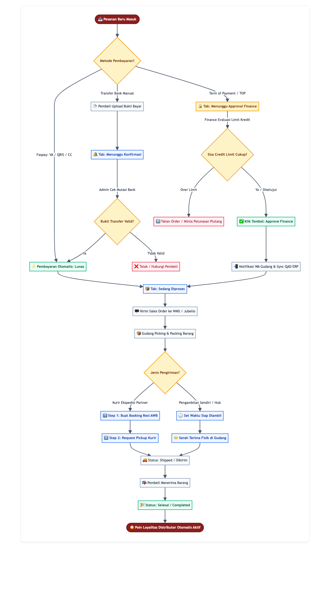
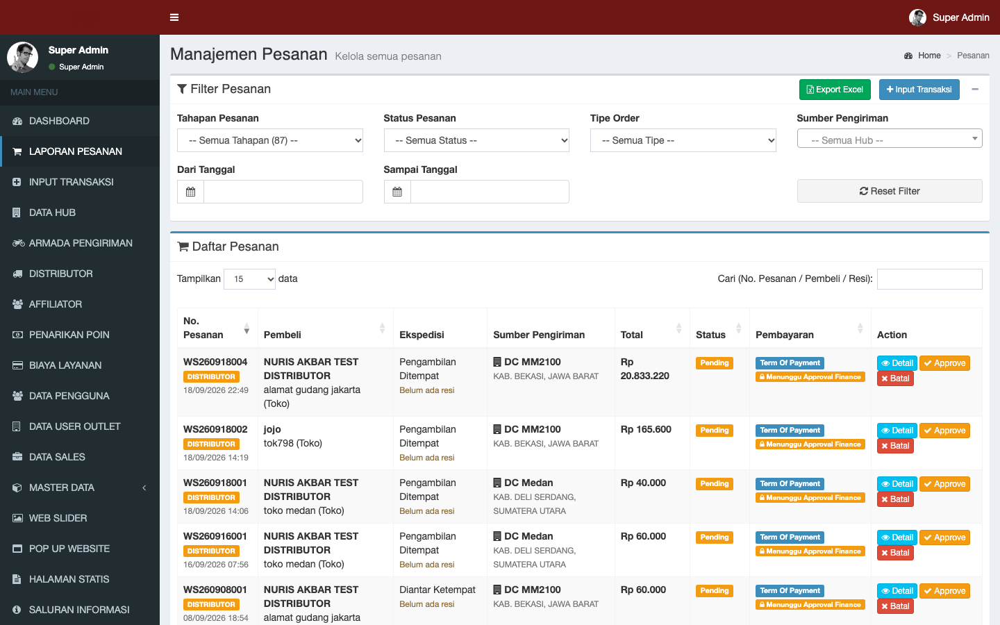
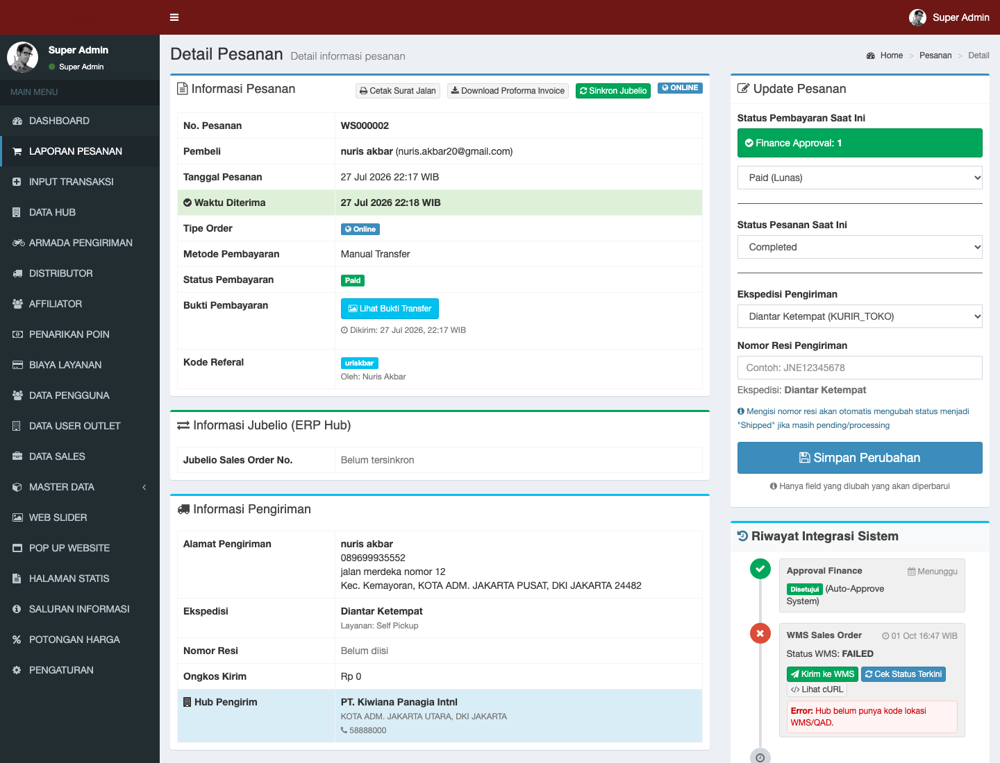
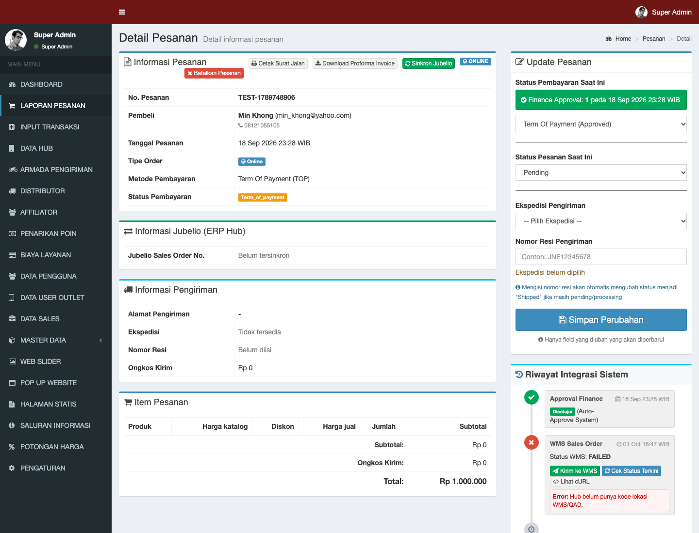
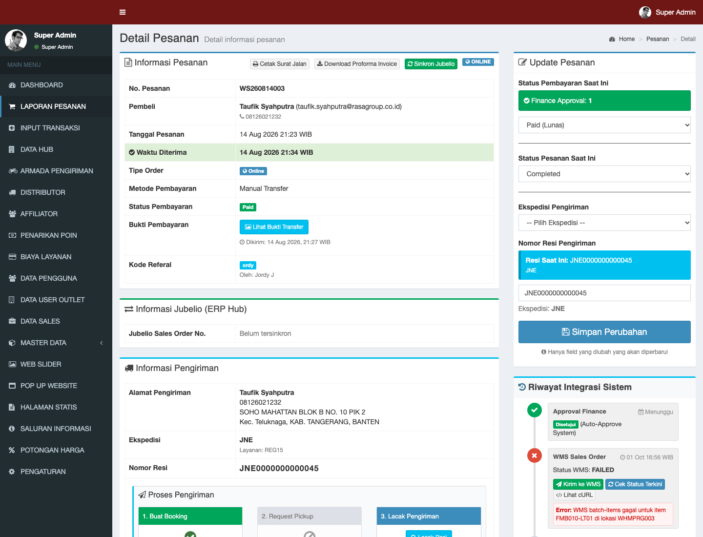
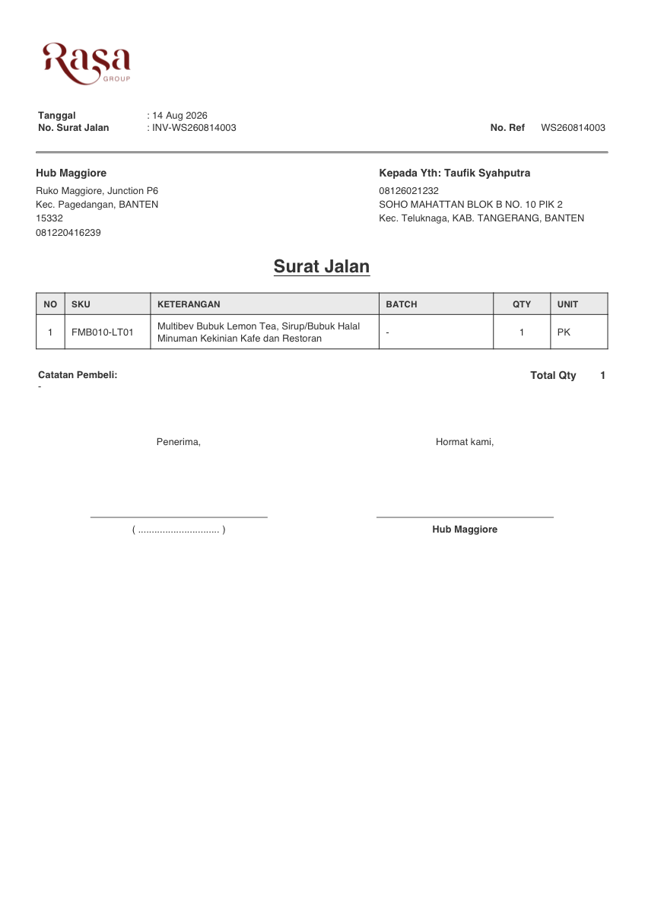
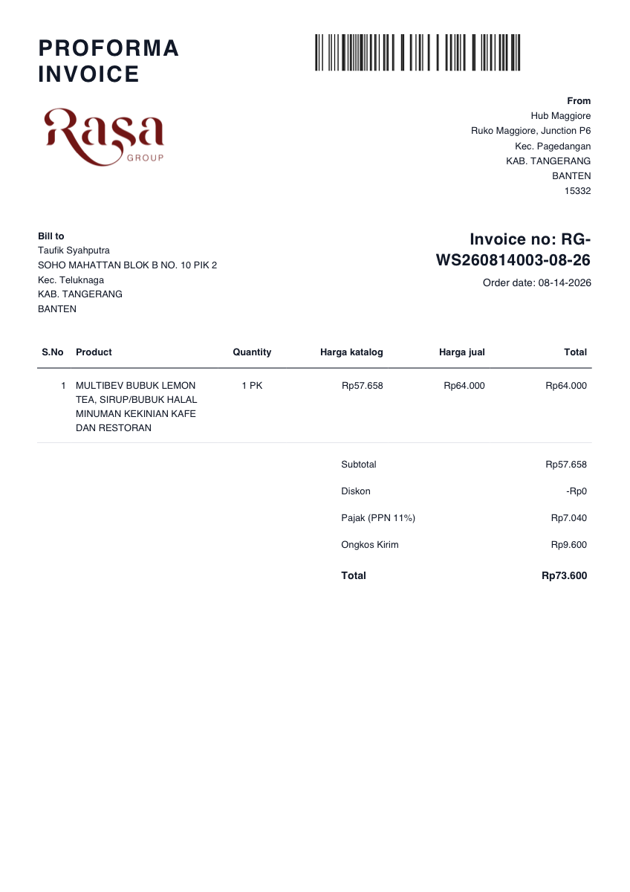

# BUKU PANDUAN OPERASIONAL ADMIN (MANUAL BOOK)
## Penerimaan, Verifikasi & Pemrosesan Pesanan Portal RasaConnect
**Versi Dokumen:** 2.0 | **Tanggal Rilis:** Oktober 2026  
**Klasifikasi:** Internal Operational Guide (SOP) | **Target Pengguna:** Admin CS, Admin Operasional Hub, & Tim Finance

---

## DAFTAR ISI

| No. | Bagian Panduan | Uraian Prosedur Operasional |
| :---: | :--- | :--- |
| **1** | Pendahuluan & Gambaran Umum | Klasifikasi Pesanan (Retail Online & Distributor TOP) & Bagan Alur Siklus Pesanan |
| **2** | Navigasi Dashboard & Filter | Pemahaman 6 Tahapan Pesanan (Tab Filter Status), Pencarian, & Fitur Export Excel |
| **3** | SOP Verifikasi Pembayaran | • 3.1. Pembayaran Otomatis (Payment Gateway Faspay) • 3.2. Pembayaran Transfer Manual (Verifikasi Bukti Transfer) • 3.3. Persetujuan Kredit Distributor (Term of Payment - TOP) |
| **4** | Pemrosesan & Integrasi Sistem | • 4.1. Pemeriksaan Detail Item & Alokasi Hub Pengirim • 4.2. Sinkronisasi ke QAD ERP (Pesanan Distributor) • 4.3. Sinkronisasi ke Jubelio ERP (Pesanan Retail / Hub) • 4.4. Pengiriman Sales Order ke WMS Gudang |
| **5** | Pengelolaan Pengiriman & Logistik | • 5.1. Metode Ekspedisi Partner (EkspedisiKu: Booking Resi, Pickup, Lacak) • 5.2. Metode Pengambilan Mandiri di Hub (Self-Pickup) |
| **6** | Dokumen Operasional | • 6.1. Cetak Surat Jalan Resmi (Delivery Note) • 6.2. Unduh Proforma Invoice Resmi |
| **7** | Penyelesaian & Pembatalan | • 7.1. Konfirmasi Selesai & Kredit Poin Loyalitas Distributor • 7.2. Prosedur Pembatalan Pesanan (Cancel Order) & Safety Guard |
| **8** | Panduan Troubleshooting & FAQ | Penanganan Status Terkunci, Error Booking Ekspedisi, dan Gagal Sinkron QAD |
| **9** | Glosarium Status & Sistem | Kamus Definisi Status Pesanan, Pembayaran, Otorisasi Finance, dan Logistik |

---

## 1. PENDAHULUAN & GAMBARAN UMUM SIKLUS PESANAN

Portal **RasaConnect** mengelola 2 (dua) kategori pesanan utama yang berasal dari kanal penjualan Rasa Group:
1. **Online (Regular)**: Transaksi pelanggan langsung melalui e-commerce/web store retail B2C.
2. **Distributor**: Transaksi grosir B2B dari mitra distributor terdaftar yang menggunakan termin pembayaran (*Term of Payment* / TOP) atau transfer, dengan verifikasi dokumen *Purchase Order* (PO).

### Diagram Alur Siklus Pesanan (End-to-End Workflow)

*Bagan 1.1: Diagram Alur Logika Pemrosesan Pesanan dari Checkout, Verifikasi Pembayaran, Integrasi WMS/ERP, hingga Pengiriman dan Selesai.*

---

## 2. NAVIGASI DASHBOARD & TAHAPAN PESANAN (TAB FILTER)

Untuk mengakses daftar transaksi, masuk ke menu samping kiri: **Laporan Pesanan &rarr; Pesanan** (akses URL: `https://rasaconnect.com/admin/orders`).

*Gambar 2.1: Antarmuka Daftar Pesanan Admin RasaConnect dengan Filter Tahapan, Tipe Order, dan Sumber Hub Pengirim.*

### A. Memahami 6 Tahapan Pesanan (Tab Filter Status)
Halaman ini dilengkapi dengan dropdown **Tahapan Pesanan** yang berfungsi memfilter transaksi berdasarkan urgensi tindak lanjut admin:

| Nama Tahapan | Indikator Sistem | Arti & Tindakan Utama Admin |
| :--- | :--- | :--- |
| **Semua Tahapan** | `countSemua` | Menampilkan seluruh riwayat transaksi aktif maupun arsip. |
| **Menunggu Pembayaran** | `pending` (tanpa bukti bayar) | Pembeli belum menyelesaikan pembayaran di gateway Faspay atau belum mengunggah bukti transfer. Pantau batas waktu kedaluwarsa. |
| **Menunggu Approval Finance** | `term_of_payment` & `finance_approved = 0` | Khusus pesanan **Distributor TOP**. Status pesanan terkunci bagi staf operasional hingga tim Finance memeriksa limit kredit dan menyetujuinya. |
| **Menunggu Konfirmasi** | `pending` + bukti transfer terunggah | Pesanan transfer manual dengan unggahan foto bukti bayar. Menampilkan tombol oranye **Verifikasi**. Admin wajib mencocokkan mutasi rekening bank. |
| **Sedang Diproses** | `processing` / lunas / TOP approved | Pembayaran aman. Pesanan siap diteruskan ke gudang (WMS) dan disiapkan barangnya. |
| **Dikirim** | `shipped` | Barang sudah memiliki nomor resi kurir atau telah diambil langsung oleh pembeli di gudang. |
| **Selesai** | `delivered` / `completed` | Barang telah diterima pelanggan. Hak poin loyalitas distributor otomatis aktif. |

### B. Fitur Filter Pendukung
- **Sumber Pengiriman**: Menyaring pesanan berdasarkan Hub pengirim (misal: *DC MM2100 Bekasi*, *DC Medan*, *Hub Maggiore*).
- **Tipe Order**: Memisahkan transaksi *Regular (Online)* dan *Distributor*.
- **Export Excel**: Tombol hijau di pojok kanan atas untuk mengunduh rekapitulasi data pesanan harian atau bulanan ke dalam format spreadsheet Excel (.xlsx).

---

## 3. SOP VERIFIKASI PEMBAYARAN

### 3.1. Pembayaran Otomatis (Payment Gateway Faspay)
- **Metode**: Virtual Account (BCA, Mandiri, BRI, Permata, BNI), QRIS, E-Wallet, dan Kartu Kredit.
- **Prosedur Admin**:
  1. Pelanggan menyelesaikan pembayaran melalui channel perbankan terkait.
  2. Sistem Faspay mengirimkan *webhook callback* secara instan ke server RasaConnect.
  3. Status pembayaran otomatis berubah menjadi **Paid** dan status pesanan berpindah ke tab **Sedang Diproses**.
  4. **Admin tidak perlu menekan tombol verifikasi.** Transaksi dapat langsung diproses ke gudang.

---

### 3.2. Pembayaran Transfer Manual (Verifikasi Bukti Transfer)
Metode transfer manual antar-rekening bank memerlukan pemeriksaan fisik buku rekening atau *internet banking* perusahaan sebelum barang disiapkan.

*Gambar 3.1: Halaman Verifikasi Pembayaran Manual dengan Tautan Bukti Transfer dan Form Pembaruan Status.*

#### Langkah-Langkah Verifikasi Admin:
1. Buka filter tahapan **Menunggu Konfirmasi**.
2. Pada baris transaksi yang bersangkutan, klik tombol oranye **Verifikasi** atau buka **Detail Pesanan**.
3. Di tabel **Informasi Pesanan**, periksa baris **Bukti Pembayaran**:
   - Klik tombol biru **Lihat Bukti Transfer** untuk membuka gambar bukti bayar.
   - Cek rincian: nama pengirim, bank asal, nominal angka (harus tepat hingga digit terakhir), tanggal transaksi, dan nomor referensi.
4. Buka *Internet Banking Corporate* Rasa Group:
   - Pastikan dana sudah **efektif masuk** di mutasi rekening koran perusahaan (bukan transfer terjadwal atau *pending* kliring).
5. Pada panel kanan (**Update Pesanan**):
   - Ubah dropdown **Status Pembayaran Saat Ini** &rarr; pilih **Paid (Lunas)**.
   - Klik tombol biru **Simpan Perubahan**.
6. Sistem akan otomatis membuka kunci pesanan dan memindahkannya ke tab **Sedang Diproses**.

> [!WARNING]
> Jangan pernah menyetujui transaksi jika gambar bukti transfer buram, berupa struk transfer terjadwal (*scheduled payment*), atau nominal mutasi bank tidak cocok dengan total tagihan.

---

### 3.3. Persetujuan Kredit Distributor (Term of Payment - TOP)
Mitra distributor resmi memiliki fasilitas termin pembayaran (tempo 30, 45, atau 60 hari). Setiap transaksi baru akan dievaluasi oleh **Tim Finance**.

*Gambar 3.2: Informasi Finansial Distributor, Status Approval Finance, dan Riwayat Integrasi Sistem.*

#### Langkah-Langkah Otorisasi Tim Finance:
1. Masuk ke filter tahapan **Menunggu Approval Finance**.
2. Klik tombol kuning **Approve** atau buka **Detail Pesanan**.
3. Periksa panel **Informasi Finansial Distributor**:
   - **Credit Limit**: Total plafon kredit yang terdaftar untuk distributor tersebut.
   - **AR Outstanding**: Total piutang dagang berjalan distributor yang belum lunas.
   - **Sisa Limit Kredit**: Selisih kredit (`Credit Limit` minus `AR Outstanding`).
   - Dokumen PO: Jika distributor melampirkan Purchase Order resmi, klik tombol **Lihat PDF** untuk mencocokkan nomor PO mitra.
4. **Evaluasi Kelayakan:**
   - **Disetujui**: Jika nominal pesanan baru masih berada di dalam batas sisa limit kredit dan mitra tidak memiliki tunggakan jatuh tempo (*overdue*).
   - **Over Limit (Peringatan Merah)**: Jika pesanan melebihi limit, sistem menampilkan label `Over Limit`. Hubungi tim Sales agar distributor melakukan pembayaran piutang lama terlebih dahulu sebelum transaksi baru disetujui.
5. **Eksekusi Approval:**
   - Pada kotak peringatan kuning di panel kanan, klik tombol hijau: **Approve Finance (set ke 1)**.
   - Konfirmasi dialog: *"Setujui TOP ini (Finance Approval = 1) dan lepaskan ke hub?"*.
6. **Otomatisasi Sistem Pasca Approval:**
   - Status approval berubah menjadi `Finance Approval: 1`.
   - Webhook notifikasi WhatsApp otomatis terkirim ke staf gudang hub pengirim.
   - Sistem memicu pembuatan *Sales Order* di **QAD ERP** dan pengiriman data ke **WMS**.

---

## 4. PEMROSESAN PESANAN & INTEGRASI SISTEM (ERP & WMS)

Setelah pesanan berstatus **Paid** atau **Finance Approved: 1**, status order beralih menjadi **Processing (Sedang Diproses)**.

### 4.1. Pemeriksaan Detail Item & Alokasi Hub Pengirim
- Periksa tabel **Item Pesanan**: pastikan nama produk, kemasan (*pack/karton*), jumlah kuantiti, dan diskon telah akurat.
- Periksa **Hub Pengirim**: pastikan hub yang ditunjuk memiliki ketersediaan stok fisik barang.

### 4.2. Sinkronisasi ke QAD ERP (Pesanan Distributor)
Untuk pesanan distributor, data wajib tercatat di QAD ERP untuk pemotongan *master stock holding* dan pembukuan piutang:
- Jika status tertera **Belum tersinkron**, klik tombol hijau di header atas: **[Sinkron QAD]**.
- Untuk menyegarkan respons ERP, klik tombol **[Cek Status Terkini]**.
- Sistem menampilkan:
  - **QAD Sales Order No.**: Nomor pesanan resmi di server QAD.
  - **QAD Customer Code**: Kode relasi pelanggan distributor (misal: `DB00001` atau `HUB00002`).
  - **Riwayat Sinkronisasi QAD**: Menampilkan log pengiriman payload dan respons balik. Jika gagal (*Failed*), klik tautan *[Lihat Detail JSON Payload & Response]* untuk melihat keterangan penolakan API.

### 4.3. Sinkronisasi ke Jubelio ERP (Pesanan Retail / Hub)
- Untuk pesanan online retail atau transaksi antar-hub, klik tombol **[Sinkron Jubelio]**.
- Sistem meneruskan pesanan ke sistem omnichannel Jubelio untuk sinkronisasi inventori marketplace & web.

### 4.4. Pengiriman Sales Order ke WMS Gudang
*Warehouse Management System (WMS)* digunakan oleh operator gudang untuk proses *picking* dan *packing* berbasis batch dan tanggal kedaluwarsa (*expired date*):
1. Pada panel kanan (**Riwayat Integrasi Sistem &rarr; WMS Sales Order**), klik tombol hijau: **[Kirim ke WMS]**.
2. Layar akan menampilkan indikator loading transparan (*Mengirim sales order ke WMS...*).
3. Setelah sukses, status WMS akan menjadi **SUCCESS** atau **PROCESSING**.
4. Operator gudang kini dapat memproses fisik barang menggunakan scanner WMS.

---

## 5. PENGELOLAAN PENGIRIMAN & LOGISTIK

*Gambar 5.1: Panel Pengiriman EkspedisiKu dengan Alur 3-Langkah (Booking, Pickup, Lacak).*

### 5.1. Metode Ekspedisi Partner (EkspedisiKu / JNE / Lion Parcel)
RasaConnect menyediakan alur logistik mandiri terintegrasi multikurir:

#### Step 1: Buat Booking (Generate Nomor Resi / AWB)
1. Pada kartu **1. Buat Booking**, klik tombol hijau **Buat Booking**.
2. Sistem secara otomatis menghubungi API EkspedisiKu dan menerbitkan **Nomor Resi / AWB** resmi (misal: `JNE000000000045` atau `LP-982341920`).
3. Status pesanan otomatis beralih menjadi **Shipped (Dikirim)**.
4. *Reset Booking:* Jika ada perubahan pilihan kurir sebelum barang dijemput, admin dapat menekan tombol merah **Reset Booking** untuk mengosongkan resi dan membuat booking ulang.

#### Step 2: Request Pickup (Khusus Armada Lion Parcel / Pick-up Service)
1. Setelah resi terbit, kartu **2. Request Pickup** akan aktif.
2. Klik tombol kuning **Request Pickup** untuk mengirim panggilan armada kurir ke alamat hub pengirim.
3. Status akan tercatat `Requested` beserta jam pemanggilan. Jika kurir berhalangan hadir, tersedia tombol **Cancel Pickup** dan **Request Ulang**.

#### Step 3: Lacak Pengiriman (Live Tracking)
1. Klik tombol biru **Lacak Resi**.
2. Sistem akan membuka modal pelacakan riwayat perjalanan paket secara real-time (*Manifested, On Transit, Out for Delivery, Delivered*).

---

### 5.2. Metode Pengambilan Mandiri di Hub (Self-Pickup)
Digunakan ketika pembeli atau kurir pihak pembeli mengambil langsung barang ke gudang Rasa Group:
1. Buka formulir kanan (**Update Pesanan**).
2. **Tanggal & Waktu Siap Diambil (`pickup_ready_at`)**: Masukkan jadwal kapan barang selesai dikemas dan siap diambil.
3. **Catatan Pengambilan**: Cantumkan detail instruksi (misal: *"Gudang Utama Lantai 1 Gate A, harap tunjukkan nomor pesanan ini ke petugas gudang"*).
4. Klik **Simpan Perubahan**. Sistem otomatis mengirimkan notifikasi WhatsApp ke pembeli bahwa barang sudah siap diambil.
5. **Serah Terima Fisik Barang:**
   - Saat pembeli tiba dan barang diserahkan, input kolom **Tanggal & Waktu Diserahkan / Diambil Pembeli (Handover)** (`shipped_at`).
   - Klik **Simpan Perubahan**. Status pesanan otomatis berubah menjadi **Dikirim (Diserahkan)**.

---

## 6. DOKUMEN OPERASIONAL: CETAK SURAT JALAN & INVOICE

Dokumen resmi wajib dicetak sebelum barang keluar dari gerbang pergudangan. Tombol cetak berada di bagian atas halaman detail pesanan:

### 6.1. Cetak Surat Jalan (Delivery Note)
- **Fungsi**: Bukti fisik pengeluaran barang resmi dan tanda terima serah terima 3 pihak (Gudang, Driver/Kurir, dan Penerima).
- **Cara Mencetak**:
  1. Klik tombol **[Cetak Surat Jalan]**.
  2. Browser akan membuka dokumen Surat Jalan PDF siap cetak.
  3. Dokumen memuat: No. Surat Jalan, No. Pesanan, Nama Hub Pengirim, Alamat Penerima, SKU Produk, Keterangan, Batch, Kuantiti, Satuan (PK/Karton), serta 2 kolom tanda tangan (*Penerima* & *Hormat Kami - Hub Pengirim*).
  4. Cetak rangkap 2 (1 lembar untuk arsip hub, 1 lembar menyertai fisik paket).

*Gambar 6.1: Dokumen Surat Jalan Resmi Rasa Group (Delivery Note).*

---

### 6.2. Unduh Proforma Invoice
- **Fungsi**: Dokumen penagihan resmi yang mencantumkan rincian perpajakan (DPP & PPN 11%) serta nomor rekening bank resmi perusahaan.
- **Cara Mengunduh**:
  1. Klik tombol **[Download Proforma Invoice]**.
  2. File PDF otomatis terunduh dengan nomor invoice unik (format: `RG-[NoPesanan]-[Bulan]-[Tahun]`), lengkap dengan barcode transaksi, rincian harga katalog, harga jual, subtotal, diskon, PPN 11%, dan ongkos kirim.

*Gambar 6.2: Dokumen Proforma Invoice Resmi Rasa Group.*

---

## 7. PENYELESAIAN TRANSAKSI & PEMBATALAN PESANAN

### 7.1. Konfirmasi Pesanan Selesai & Kredit Poin Distributor
1. **Pembaruan Status Selesai**:
   - Jika kurir partner mengonfirmasi paket telah terkirim (*Delivered*), atau pelanggan menekan tombol konfirmasi penerimaan barang di portal pembeli, status pesanan beralih menjadi **Delivered / Completed**.
   - Admin juga dapat memperbarui status secara manual melalui formulir kanan: pilih **Status Pesanan Saat Ini &rarr; Completed**.
2. **Kredit Poin Loyalitas Distributor**:
   - Untuk pesanan **Distributor**, saat status mencapai **Completed**, sistem akan secara otomatis mengkreditkan poin reward (`points_earned`) ke saldo akun distributor tersebut.
   - Status poin di ringkasan total akan berubah dari label default `Pending` menjadi label hijau `Dikreditkan`.

---

### 7.2. Prosedur Pembatalan Pesanan (Cancel Order)
Pembatalan pesanan hanya boleh dilakukan sebelum barang dikirim dan memiliki alasan yang sah (contoh: persetujuan finance ditolak, pembeli meminta pembatalan sebelum diproses, atau stok barang rusak).

> [!CAUTION]
> Pesanan yang sudah berstatus `Shipped`, `Delivered`, atau `Completed` **tidak dapat dibatalkan** melalui tombol pembatalan standar. Jika terjadi retur fisik, jalankan prosedur Retur Barang Khusus.

#### Langkah Pembatalan:
1. Buka halaman detail pesanan yang akan dibatalkan.
2. Di pojok kanan atas kotak Informasi Pesanan, klik tombol merah: **[Batalkan Pesanan]**.
3. Browser akan memunculkan dialog konfirmasi: *"Apakah Anda yakin ingin membatalkan pesanan ini?"*.
4. Klik **OK**.
5. Sistem akan:
   - Mengubah status pesanan menjadi **Cancelled**.
   - Mengembalikan saldo limit kredit distributor (jika sempat terpotong).
   - Membatalkan antrean sinkronisasi WMS/ERP.

---

## 8. PANDUAN PENANGANAN MASALAH (TROUBLESHOOTING & FAQ)

### Q1: Mengapa formulir status pesanan di sebelah kanan terkunci dan tidak bisa diubah?
> **Penyebab:** Sistem menerapkan pengaman (*safety lock*). Pesanan yang belum lunas atau pesanan TOP distributor yang belum di-approve finance secara otomatis mengunci dropdown status agar barang tidak keluar sebelum kepastian pembayaran aman.  
> **Solusi:** Selesaikan verifikasi transfer manual (ubah status pembayaran ke *Paid*) atau minta otorisasi tim Finance untuk menekan tombol *Approve Finance*.

---

### Q2: Saat mengklik "Buat Booking" EkspedisiKu, muncul pesan error merah di bawah tombol. Bagaimana solusinya?
> **Penyebab:** Umumnya disebabkan oleh kelengkapan data alamat pengiriman penerima atau pengirim (misal: kode pos tidak valid, nomor handphone kurang digit, atau berat produk pada master item bernilai 0 gram).  
> **Solusi:**
> 1. Periksa kelengkapan alamat penerima pada kartu Informasi Pengiriman.
> 2. Pastikan berat item produk pada master data telah terisi dengan benar.
> 3. Jika pesan bertuliskan API timeout, tunggu 1-2 menit lalu klik tombol kembali.

---

### Q3: Riwayat sinkronisasi QAD bertanda merah (Failed). Apa yang harus dilakukan?
> **Penyebab:** Server QAD ERP menolak format data (misal: masa berlaku kredit habis, kode item belum dipetakan di QAD, atau customer code tidak ditemukan).  
> **Solusi:**
> 1. Klik tautan *[Lihat Detail JSON Payload & Response]* pada tabel Riwayat Sinkronisasi QAD.
> 2. Periksa baris error respons (misal: `"Credit terms not found"` atau `"Invalid Item Code"`).
> 3. Lakukan perbaikan data master terkait.
> 4. Klik tombol **[Sinkron QAD]** di kanan atas untuk mengirim ulang data perbaikan ke server ERP.

---

### Q4: Apakah nomor resi pengiriman dapat diganti jika salah ketik manual?
> **Solusi:** Ya. Ketikkan nomor resi yang benar pada input field **Nomor Resi Pengiriman** di formulir sebelah kanan, lalu klik **Simpan Perubahan**. Sistem akan langsung memperbarui data pelacakan resi ke nomor yang baru.

---

## 9. GLOSARIUM STATUS & INDIKATOR SISTEM

| Istilah / Status | Kategori | Penjelasan & Makna Sistem |
| :--- | :--- | :--- |
| **Pending** | Status Pesanan | Transaksi baru dibuat, menunggu verifikasi pembayaran atau approval limit kredit. |
| **Processing** | Status Pesanan | Pembayaran telah terkonfirmasi aman. Barang sedang dikemas atau disiapkan di WMS. |
| **Shipped** | Status Pesanan | Barang telah memiliki nomor resi kurir valid atau telah diserahkan di gudang. |
| **Delivered** | Status Pesanan | Kurir melaporkan bahwa barang telah sampai di alamat tujuan penerima. |
| **Completed** | Status Pesanan | Transaksi tuntas sempurna. Hak poin reward telah masuk ke saldo mitra distributor. |
| **Cancelled** | Status Pesanan | Pesanan dibatalkan permanen; stok inventori dan limit kredit dikembalikan. |
| **Paid** | Status Pembayaran | Pembayaran telah lunas (baik via Faspay otomatis maupun transfer bank manual). |
| **Term of Payment** | Status Pembayaran | Skema transaksi kredit berjangka (tempo) khusus mitra distributor terverifikasi. |
| **Finance Approval: 1** | Indikator Otorisasi | Transaksi kredit TOP telah disetujui resmi oleh Finance dan dilepaskan ke operasional hub. |
| **Finance Approval: 0** | Indikator Otorisasi | Transaksi kredit TOP masih tertahan, menunggu evaluasi kelayakan kredit dari tim Finance. |
| **AR Outstanding** | Finansial | *Account Receivable* — total tagihan piutang distributor yang saat ini masih belum dilunasi. |
| **Self-Pickup** | Logistik | Metode pengambilan mandiri barang oleh pembeli/kurir pembeli di gudang hub Rasa Group. |
| **EkspedisiKu** | Logistik | Layanan integrasi multikurir agregator (Lion Parcel, JNE, SiCepat) dengan fitur otomatisasi AWB. |

---
*Manual Book ini dikelola secara berkala oleh Tim Product & Teknologi Rasa Group. Untuk pertanyaan lebih lanjut atau kendala sistem, hubungi tim IT Helpdesk.*
