# BUKU PANDUAN OPERASIONAL ADMIN MASTER (MASTER MANUAL BOOK)
## Tata Kelola Seluruh Modul & Operasional Sistem Portal RasaConnect
**Versi Dokumen:** 3.0 | **Tanggal Rilis:** Oktober 2026  
**Klasifikasi:** Dokumen Prosedur Operasional Standar (SOP) Internal Perusahaan  
**Target Pengguna:** Super Admin, Admin E-Commerce / CS, Operasional Hub & Gudang, Tim Finance & Accounting, Tim Sales & Marketing, Tim Logistik & Ekspedisi

---

## DAFTAR ISI

| Bagian | Modul & Topik Panduan | Ruang Lingkup & Uraian Prosedur |
| :---: | :--- | :--- |
| **1** | Pengantar Sistem & Matriks Akses (RBAC) | Visi portal, arsitektur modul, dan matriks hak akses per role pengguna |
| **2** | Navigasi Dashboard & Monitoring Bisnis | Ringkasan KPI bisnis, widget GMV snapshot, dan grafik tren performa |
| **3** | Modul Manajemen Pesanan (Orders) | Verifikasi pembayaran, approval kredit TOP, integrasi ERP/WMS, logistik, dokumen resmi, dan pembatalan |
| **4** | Modul Input Transaksi Manual (POS / Kasir) | Pembuatan pesanan langsung oleh tim backoffice/kasir untuk retail offline & pesanan darurat |
| **5** | Modul Laporan & Analisis GMV | Analisis Gross GMV, Net Merchandise Value (NMV), diskon efektif, realized revenue, waterfall, dan export Excel |
| **6** | Modul Manajemen Hub & Pergudangan | Master gudang/hub, pemetaan multi-sistem (QAD, Jubelio, Zoho Books), kontrol stok WMS multi-batch & mutasi |
| **7** | Modul Armada Pengiriman & Driver Internal | Master kendaraan perusahaan, penugasan kurir internal, kapasitas muat, dan tracking pengiriman mandiri |
| **8** | Modul Manajemen Distributor B2B | Verifikasi aplikasi mitra, manajemen credit limit & termin TOP, target belanja, diskon kategori, dan sync QAD |
| **9** | Modul Kemitraan Affiliator (DRiiPPreneur) | Verifikasi kelayakan, mekanisme komisi poin referral, dan SOP persetujuan penarikan poin (pencairan dana) |
| **10** | Modul Finansial: Biaya Layanan Pembayaran | Konfigurasi tarif fee gateway per kanal (VA, QRIS, CC) dan kebijakan pembebanan biaya |
| **11** | Modul Manajemen Pengguna & Outlet | Pengelolaan user pelanggan (buyer/reseller), perizinan akses admin, dan pemetaan cabang outlet fisik |
| **12** | Modul Manajemen Tim Sales | Master salesperson, kode sales unik, atribusi omset pesanan, dan monitoring performa sales |
| **13** | Modul Master Data Katalog Produk | Pengelolaan SKU, Brand, Kategori, Level Harga, Potongan Kartonan (Tier), Kupon Promo, dan Sync Jubelio/QID |
| **14** | Modul Konten Website & Pemasaran | Pengelolaan Web Slider, Pop-up Website, Halaman CMS Statis, Saluran Informasi/Blog, dan Menu Navigasi |
| **15** | Modul Pengaturan Sistem Terpusat | Profil perusahaan, kontak CS, PPN 11%, rasio konversi poin DRiiPPreneur, dan aktivasi partner ekspedisi |
| **16** | Matriks Integrasi Sistem Eksternal | SOP sinkronisasi multi-sistem: QAD ERP, Jubelio Omnichannel, Zoho Books, WMS, Gateway Faspay, EkspedisiKu & J&T |
| **17** | Panduan Troubleshooting & FAQ | Penanganan error umum sistem, kegagalan sinkronisasi API, status terkunci, dan koreksi data |
| **18** | Glosarium Istilah Sistem | Kamus terminologi finansial, inventori, logistik, dan status teknis RasaConnect |

---

## 1. PENGANTAR SISTEM & MATRIKS HAK AKSES (RBAC)

Portal **RasaConnect** adalah platform *Enterprise Commerce & Distribution Hub* terpadu milik Rasa Group yang menghubungkan kanal ritel B2C, kemitraan B2B (Distributor & Reseller), program kemitraan komunitas (DRiiPPreneur Affiliator), sistem pergudangan multi-hub, serta integrasi otomatis ke ekosistem ERP dan akuntansi korporat.

### Matriks Hak Akses Berdasarkan Role (Role-Based Access Control / RBAC)

Sistem membatasi akses menu dan wewenang eksekusi berdasarkan peran kerja masing-masing divisi:

| Modul / Menu Navigasi | Super Admin | E-Commerce / CS | Finance | Hub / Gudang | Sales Admin | Brand Marketing | IT / App Admin |
| :--- | :---: | :---: | :---: | :---: | :---: | :---: | :---: |
| **Dashboard & GMV Snapshot** | Full | Full | Full | View | Full | View | Full |
| **Laporan Pesanan (Orders)** | Full | Full | Full (Approve) | View | Full | View | Full |
| **Input Transaksi Manual** | Full | Full | No | No | Full | No | Full |
| **Laporan & Analisis GMV** | Full | Full | Full | No | Full | Full | Full |
| **Data Hub & Stok Inventori** | Full | View | No | Full | View | No | Full |
| **Armada Pengiriman** | Full | No | No | Full | No | No | Full |
| **Distributor & Legalitas** | Full | View | Full (Limit) | View | Full | No | Full |
| **Affiliator (DRiiPPreneur)** | Full | Full | View | No | Full | Full | Full |
| **Penarikan Poin (Withdrawal)** | Full | View | Full (Cairkan)| No | View | No | Full |
| **Biaya Layanan (Payment Fees)** | Full | No | Full | No | No | No | Full |
| **Data Pengguna & Outlet** | Full | Full | View | No | View | No | Full |
| **Data Sales & Atribusi** | Full | Full | View | No | Full | View | Full |
| **Master Produk, Brand, Kategori** | Full | Full | View | View | Full | Full | Full |
| **Level Harga & Potongan Diskon**| Full | Full | View | No | Full | No | Full |
| **Konten Web, Banner & Pop-up** | Full | No | No | No | No | Full | Full |
| **Pengaturan Sistem (Settings)** | Full | No | No | No | No | No | Full |

---

## 2. NAVIGASI DASHBOARD & MONITORING BISNIS

Dashboard admin (`/admin/dashboard`) adalah pusat komando visual untuk memantau performa harian dan bulanan seluruh lini usaha Rasa Group.

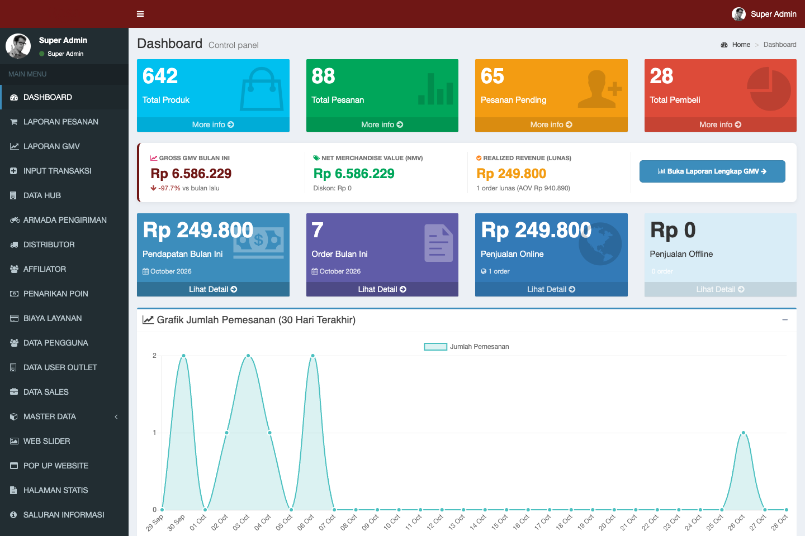
*Gambar 2.1: Antarmuka Dashboard Admin dengan Kartu Metrik, Widget Snapshot GMV Bulan Berjalan, dan Grafik Tren Pesanan.*

### A. Kartu Indikator Utama (Executive Metric Cards)
1. **Total Produk**: Jumlah SKU aktif dalam katalog sistem.
2. **Total Pesanan**: Akumulasi pesanan yang pernah tercatat.
3. **Pesanan Pending**: Jumlah transaksi yang menunggu pembayaran pelanggan atau tindakan operasional.
4. **Total Pembeli & Mitra**: Jumlah pelanggan ritel, reseller, distributor, dan affiliator terdaftar.

### B. Widget Snapshot GMV & Rekonsiliasi Bulan Berjalan
Di baris atas dashboard, terdapat widget visual performa penjualan bulan berjalan:
- **Gross GMV Bulan Ini**: Total nilai kotor pesanan sebelum dikurangi diskon & ongkir. Dilengkapi indikator persentase pertumbuhan (*growth rate*) dibandingkan bulan lalu.
- **Net Merchandise Value (NMV)**: Nilai bersih penjualan barang setelah potongan promo dan diskon bertingkat.
- **Realized Revenue (Lunas)**: Total dana riil yang telah masuk ke rekening perusahaan dari pesanan berstatus *paid*.
- **Tombol Pintas**: Tombol biru *[Buka Laporan Lengkap GMV]* untuk langsung menuju modul analisis mendalam.

### C. Grafik Interaktif
- **Grafik Tren Pemesanan (30 Hari Terakhir)**: Menampilkan fluktuasi volume order harian.
- **Grafik Distribusi Pesanan per Hub**: Menampilkan proporsi beban pengiriman pada masing-masing Hub/Warehouse aktif.

---

## 3. MODUL MANAJEMEN PESANAN (ORDERS MANAGEMENT)

Menu: **Laporan Pesanan &rarr; Pesanan** (`/admin/orders`)

Portal mengelola 2 (dua) jenis pesanan utama:
1. **Online (Regular)**: Transaksi e-commerce ritel pelanggan umum (B2C).
2. **Distributor**: Transaksi pesanan partai besar dari mitra distributor terdaftar yang menggunakan termin pembayaran (*Term of Payment* / TOP) atau pembayaran langsung, dengan verifikasi dokumen *Purchase Order* (PO).


*Bagan 3.1: Diagram Alur Logika Pemrosesan Pesanan dari Checkout, Verifikasi Pembayaran, Integrasi WMS/ERP, hingga Pengiriman dan Selesai.*

---

### 3.1. Filter Tahapan Pesanan (Workflow Pipeline)
Dropdown **Tahapan Pesanan** membagi transaksi ke dalam antrean kerja:


*Gambar 3.2: Antarmuka Daftar Pesanan Admin dengan Filter Tahapan, Tipe Order, dan Sumber Hub Pengirim.*

| Tahapan Pesanan | Indikator Sistem | Arti & Prosedur Tindak Lanjut Admin |
| :--- | :--- | :--- |
| **Semua Tahapan** | `countSemua` | Menampilkan seluruh riwayat transaksi aktif maupun arsip. |
| **Menunggu Pembayaran** | `pending` | Pembeli belum menyelesaikan pembayaran via payment gateway Faspay. Pesanan otomatis kedaluwarsa jika melewati batas toleransi waktu pembayaran. |
| **Menunggu Approval Finance** | `term_of_payment` & `finance_approved = 0` | Khusus pesanan **Distributor TOP**. Transaksi terkunci hingga Tim Finance memeriksa sisa limit kredit distributor dan menyetujuinya. |
| **Sedang Diproses** | `processing` / lunas / TOP approved | Pembayaran aman / kredit disetujui. Pesanan siap dikemas oleh tim hub dan diteruskan ke WMS. |
| **Dikirim** | `shipped` | Barang telah memiliki nomor resi ekspedisi resmi atau telah diserahterimakan pada metode *Self-Pickup*. |
| **Selesai** | `delivered` / `completed` | Barang telah diterima pelanggan. Hak poin loyalitas distributor otomatis aktif. |

---

### 3.2. SOP Verifikasi Pembayaran & Approval Kredit

#### A. Pembayaran Otomatis (Payment Gateway Faspay)
- Transaksi via Virtual Account (BCA, Mandiri, BRI, BNI, Permata), QRIS, E-Wallet, dan Kartu Kredit diverifikasi otomatis oleh webhook Faspay secara instan.
- Status pembayaran otomatis berubah menjadi **Paid**, dan status pesanan berpindah ke tab **Sedang Diproses**.
- **Admin tidak perlu menekan tombol verifikasi manual.**

#### B. Persetujuan Kredit Distributor (Term of Payment - TOP)

*Gambar 3.3: Informasi Finansial Distributor, Status Approval Finance, dan Riwayat Integrasi Sistem.*

1. Tim Finance membuka filter tahapan **Menunggu Approval Finance**.
2. Buka **Detail Pesanan** dan evaluasi panel **Informasi Finansial Distributor**:
   - **Credit Limit**: Total plafon kredit yang diberikan kepada distributor.
   - **AR Outstanding**: Total piutang berjalan distributor yang belum dibayarkan.
   - **Sisa Limit Kredit**: Selisih kredit aman (`Credit Limit` minus `AR Outstanding`).
   - **Dokumen PO**: Klik tombol **Lihat PDF** untuk mencocokkan nomor PO dan tanda tangan resmi mitra.
3. **Eksekusi:**
   - Jika sisa limit mencukupi dan tidak ada tunggakan jatuh tempo (*overdue*), klik tombol hijau: **Approve Finance (set ke 1)**.
   - Sistem membuka status pesanan, memicu sinkronisasi ke QAD ERP/WMS, dan mengirim notifikasi WhatsApp otomatis ke staf gudang hub pengirim.

#### C. Verifikasi Bukti Transfer Bank Manual

*Gambar 3.4: Panel Verifikasi Bukti Pembayaran Transfer Bank Manual.*

- Jika transaksi menggunakan transfer rekening bank manual, periksa berkas bukti transfer yang diunggah pelanggan.
- Cocokkan mutasi rekening koran bank. Jika dana telah masuk efektif, ubah status pembayaran menjadi **Paid**.

---

### 3.3. Integrasi Sistem ERP, WMS, dan Akuntansi (Zoho Books)

Pada halaman detail pesanan, terdapat panel integrasi sistem terpusat:
- **Sinkronisasi QAD ERP (Pesanan Distributor)**: Klik tombol hijau **[Sinkron QAD]** untuk mencatat *Sales Order* ke sistem QAD ERP guna pemotongan saldo induk dan pencatatan piutang.
- **Sinkronisasi Jubelio ERP (Pesanan Ritel / Hub)**: Klik tombol **[Sinkron Jubelio]** untuk memotong kuota inventori omnichannel marketplace.
- **Pengiriman ke WMS Gudang**: Klik tombol **[Kirim ke WMS]** agar order masuk ke aplikasi scanner gudang untuk proses picking & packing berbasis nomor batch (*FEFO*).
- **Sinkronisasi ke Zoho Books**: Klik tombol **[Sinkron Zoho]** untuk menerbitkan *Sales Order*, *Invoice*, dan *Payment Receipt* resmi di Zoho Books. Sistem secara otomatis menyertakan pemetaan `location_id` sesuai Hub pengirim serta diskon level pesanan sebelum pajak.

---

### 3.4. Pengelolaan Pengiriman & Ekspedisi


*Gambar 3.5: Panel Pengiriman EkspedisiKu dengan Alur 3-Langkah (Booking, Pickup, Lacak).*

#### Opsi A — Buat Booking Otomatis (EkspedisiKu API Partner / Lion Parcel / J&T / JNE)
1. Pada kartu **1. Buat Booking**, periksa rincian ekspedisi, layanan kurir, bobot, dan alamat tujuan.
2. Klik tombol hijau **Buat Booking**.
3. Sistem secara otomatis menerbitkan **Nomor Resi / AWB resmi** (misal: `LP-982341920`, `JT920381023`), mengubah status menjadi **Shipped (Dikirim)**, dan mencatat waktu kirim (`shipped_at`).
4. Pada kartu **2. Request Pickup**, klik **Request Pickup** untuk memanggil kurir jemput paket di hub.
5. Pada kartu **3. Lacak Pengiriman**, klik **Lacak Resi** untuk memantau status transit barang secara real-time.

#### Opsi B — Input Resi Manual (Kurir Internal / Agen Offline / Cargo Khusus)
1. Buka formulir kanan **Update Pesanan**.
2. Masukkan nomor resi fisik pada kolom **Nomor Resi Pengiriman** (`tracking_number`).
3. Klik **Simpan Perubahan**. Sistem otomatis mengubah status menjadi **Shipped**, mencatat waktu pengiriman, dan mengirim pesan WhatsApp konfirmasi resi ke nomor pembeli.

#### Opsi C — Pengambilan Mandiri di Hub (Self-Pickup)
1. Buka formulir kanan **Update Pesanan**.
2. Isi kolom **Tanggal & Waktu Siap Diambil (`pickup_ready_at`)** dan catatan instruksi (misal: *Gudang Utama Gate A*).
3. Klik **Simpan Perubahan** (pembeli menerima WhatsApp bahwa paket siap diambil).
4. Saat barang diserahkan kepada pihak pembeli, isi kolom **Tanggal & Waktu Diserahkan (`shipped_at`)** lalu simpan.

---

### 3.5. Dokumen Resmi: Cetak Surat Jalan & Proforma Invoice
- **Surat Jalan (Delivery Note)**: Klik tombol **[Cetak Surat Jalan]** di header atas untuk mencetak dokumen tanda terima fisik rangkap 2 (1 lembar arsip hub, 1 lembar menyertai barang) lengkap dengan nomor batch, kuantiti per pack/karton, dan kolom tanda tangan 3 pihak.
- **Proforma Invoice**: Klik tombol **[Download Proforma Invoice]** untuk mengunduh berkas PDF penagihan resmi berformat barcode unik dengan rincian DPP, PPN 11%, dan rekening resmi perusahaan.


*Gambar 3.6: Dokumen Surat Jalan Resmi Rasa Group (Delivery Note).*


*Gambar 3.7: Dokumen Proforma Invoice Resmi Rasa Group.*

---

### 3.6. Penyelesaian & Pembatalan Pesanan
- **Selesai Transaksi**: Saat kurir mengonfirmasi *Delivered*, ubah status menjadi **Completed**. Poin loyalitas distributor (`points_earned`) akan otomatis dikreditkan ke saldo akun mitra.
- **Pembatalan Pesanan (Cancel Order)**: Hanya dapat dilakukan sebelum pesanan dikirim (`shipped`). Klik tombol merah **[Batalkan Pesanan]**. Sistem akan mengembalikan limit kredit distributor, membatalkan antrean ERP, dan mengubah status menjadi **Cancelled**.

---

## 4. MODUL INPUT TRANSAKSI MANUAL (POS / KASIR / BACKOFFICE)

Menu: **Laporan Pesanan &rarr; Input Transaksi** (`/admin/orders/create`)

Modul ini digunakan oleh staf e-commerce, admin sales, atau kasir showroom untuk menginput pesanan yang diterima secara offline (walk-in store), pemesanan via telepon/WhatsApp, maupun pesanan darurat distributor.

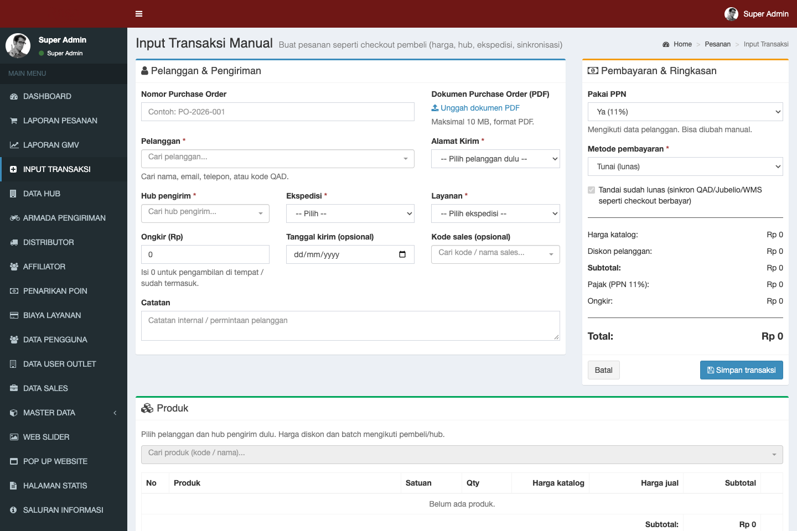
*Gambar 4.1: Antarmuka Input Transaksi Manual dengan Pencarian Pelanggan, Atribusi Sales, Level Harga Otomatis, dan Alokasi Hub.*

### Langkah-Langkah Pembuatan Pesanan Manual:
1. **Pilih Pelanggan (Customer)**:
   - Ketik nama, nomor WhatsApp, atau email pelanggan pada form pencarian AJAX.
   - Pilih akun yang sesuai, atau centang opsi *Pelanggan Baru / Tamu (Guest)* jika pembeli belum terdaftar.
2. **Pilih Salesperson / Kode Sales**:
   - Jika transaksi didampingi oleh wiraniaga tertentu, pilih nama sales agar omset transaksi tercatat ke dalam performa sales terkait.
3. **Pilih Alamat Pengiriman**:
   - Pilih salah satu alamat tersimpan dari profil pelanggan, atau masukkan alamat kirim baru lengkap dengan provinsi, kota, kecamatan, kelurahan, dan kode pos.
4. **Pilih Gudang / Hub Pengirim (`source_warehouse_id`)**:
   - Tentukan lokasi Hub/Warehouse yang bertindak sebagai pemenuhan pesanan (*fulfillment origin*).
5. **Tambahkan Item Produk**:
   - Cari produk berdasarkan SKU atau nama barang.
   - Sistem secara otomatis menerapkan level harga sesuai peran user (Retail, Reseller, atau Distributor).
   - Masukkan kuantiti (satuan botol/pack atau karton).
   - Jika gudang mengaktifkan fitur lot batch WMS, pilih nomor batch fisik yang dialokasikan.
6. **Pilih Metode Pengiriman & Pembayaran**:
   - Pilih ekspedisi (Kurir Partner, Armada Internal Toko, atau Ambil Sendiri / Self-Pickup).
   - Tentukan skema pembayaran: Transfer Bank Manual, Payment Gateway, Tunai / POS, atau Term of Payment (khusus distributor).
7. **Pratinjau Kalkulasi (Preview Pricing)**:
   - Klik **Preview Perhitungan** untuk memvalidasi subtotal, potongan diskon bertingkat/kupon, estimasi PPN 11%, dan ongkos kirim.
8. **Simpan & Terbitkan Pesanan**:
   - Klik tombol biru **Terbitkan Transaksi**. Sistem menerbitkan nomor pesanan resmi (format: `W26...` atau `D26...`) dan langsung mengarahkan admin ke halaman detail order untuk diproses lebih lanjut.

---

## 5. MODUL LAPORAN & ANALISIS GMV (GROSS MERCHANDISE VALUE)

Menu: **Laporan Pesanan &rarr; Laporan GMV** (`/admin/reports/gmv`)

Modul ini menyajikan analisis finansial komprehensif atas total volume transaksi kotor, efektivitas promosi, nilai bersih barang dagangan, dan pendapatan riil perusahaan.

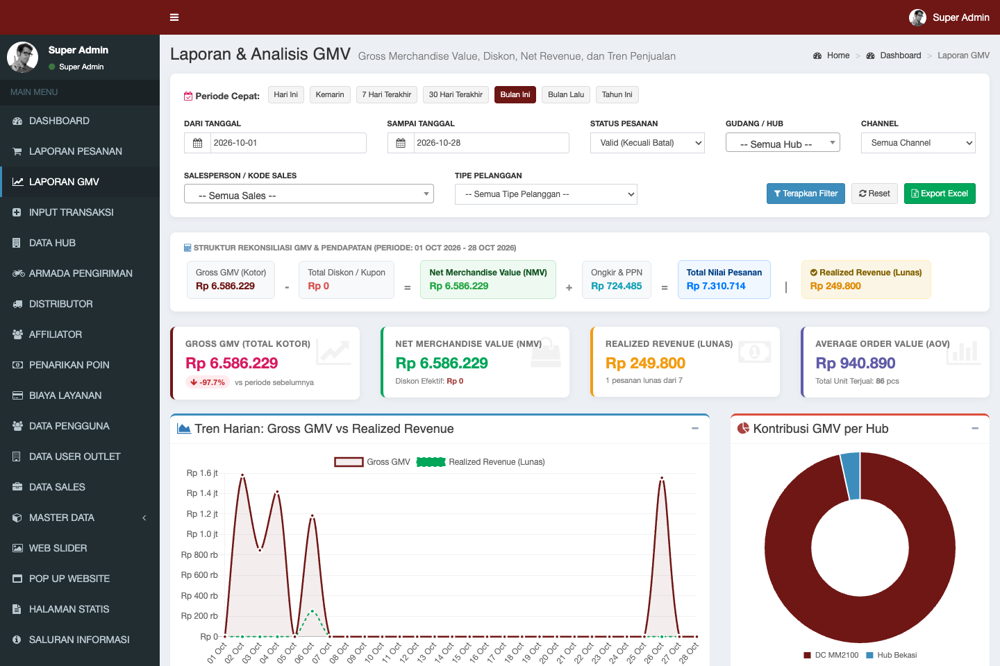
*Gambar 5.1: Antarmuka Laporan GMV dengan Filter Periode Cepat, Waterfall Rekonsiliasi, Grafik Tren Harian, dan Kontribusi per Hub.*

### 5.1. Definisi & Rumus Metrik Finansial
- **Gross GMV (Gross Merchandise Value)**: Total akumulasi nilai transaksi penjualan kotor sebelum dikurangi biaya operasional, diskon kupon, maupun ongkos kirim.  
  $$\text{Gross GMV} = \sum (\text{Harga Item} \times \text{Kuantiti Terjual})$$
- **Catalog GMV**: Estimasi total nilai transaksi jika seluruh item dihitung berdasarkan harga ritel katalog dasar.
- **Effective Discount**: Total potongan harga yang dinikmati pembeli, mencakup diskon kupon voucher promosi dan potongan harga bertingkat (*tiering cart*).
- **Net Merchandise Value (NMV)**: Nilai riil bersih dari barang dagangan setelah potongan diskon.  
  $$\text{NMV} = \text{Gross GMV} - \text{Effective Discount}$$
- **Realized Revenue (Pendapatan Terwujud)**: Total penerimaan uang riil yang sudah terkonfirmasi lunas (`payment_status = 'paid'`) dari kas/bank.
- **Average Order Value (AOV)**: Nilai rata-rata per transaksi pesanan belanja.  
  $$\text{AOV} = \frac{\text{Gross GMV}}{\text{Total Pesanan}}$$
- **Growth Percentage**: Persentase kenaikan/penurunan Gross GMV dibandingkan periode sebelumnya dengan jumlah hari yang sama.

### 5.2. Alur Rekonsiliasi (Waterfall Banner)
Halaman ini menampilkan visualisasi urutan rekonsiliasi finansial:
$$\text{Gross GMV (Kotor)} \xrightarrow{-\text{Diskon}} \text{Net Merchandise Value (NMV)} \xrightarrow{+\text{Ongkir \& PPN}} \text{Total Pesanan} \implies \text{Realized Revenue (Lunas)}$$

### 5.3. Fitur Filter Cepat & Analisis Data
- **Tombol Periode Cepat**: *Hari Ini, Kemarin, 7 Hari Terakhir, 30 Hari Terakhir, Bulan Ini, Bulan Lalu, Tahun Ini*.
- **Filter Fleksibel**: Pemilihan rentang tanggal via kalender, status pesanan (Valid, Lunas, Approved, Semua), Hub Pengirim, Channel Penjualan (Online, Sales Direct, POS), Kode Sales, dan Tipe Pelanggan.
- **Grafik Tren Harian**: Membandingkan Gross GMV harian dengan Realized Revenue dalam bentuk grafik multi-garis interaktif.
- **Grafik Donut Kontribusi Hub**: Menampilkan persentase kontribusi omset dari setiap gudang/hub fisik.
- **Papan Peringkat (Top Ranking)**:
  - Top 5 Produk Kontributor GMV Tertinggi (beserta volume kuantiti terjual).
  - Top 5 Salesperson Berdasarkan Omset Penjualan.
- **Tabel DataTables & Export Excel**:
  - Daftar transaksi rinci yang dapat dicari dan diurutkan secara server-side.
  - Tombol hijau **Export Excel** untuk mengunduh seluruh transaksi terfilter ke dalam berkas spreadsheet `.xlsx`.

---

## 6. MODUL MANAJEMEN HUB & PERGUDANGAN (WAREHOUSES & STOCKS)

Menu: **Data Hub** (`/admin/warehouses`)

Modul ini mengatur seluruh titik distribusi fisik (Distribution Center / DC dan Hub Penjualan) serta stok inventori barang di masing-masing lokasi.

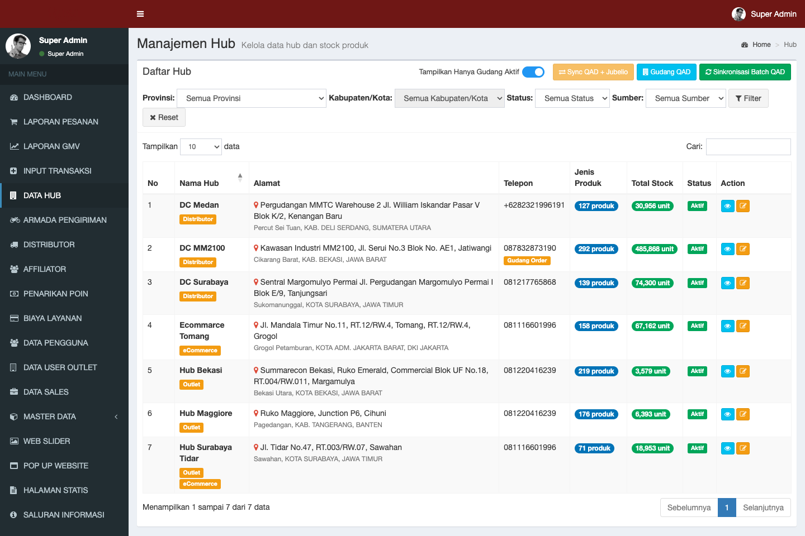
*Gambar 6.1: Antarmuka Master Hub dengan Pengaturan Wilayah Administratif, Jam Operasional, dan Pemetaan Multi-Sistem.*

### 6.1. Pengelolaan Master Hub & Identitas Lokasi
1. Menambahkan atau mengubah data Hub: Nama Hub, Kode Hub (misal: `HUB-BKS`, `HUB-MGR`), Wilayah Administratif Indonesia (Provinsi, Kabupaten/Kota, Kecamatan, Kelurahan), Alamat Lengkap, Nomor Kontak, dan Jam Operasional.
2. **Titik Koordinat Geografis (Latitude & Longitude)**: Wajib diisi dengan akurat karena digunakan oleh mesin penentu kurir instan/same-day (Lalamove & GoSend) untuk menghitung jarak tempuh penjemputan barang.

### 6.2. Konfigurasi Pemetaan Multi-Sistem (Integration Mapping)
Agar setiap transaksi dan mutasi barang terhubung akurat ke sistem eksternal, setiap Hub wajib dipetakan:
- **QAD Location Code**: Kode lokasi gudang di sistem QAD ERP (contoh: `1001`, `1002`).
- **Jubelio Location ID**: ID gudang terdaftar di Jubelio Omnichannel.
- **Zoho Books Branch & Location ID**: ID cabang/gudang di Zoho Books (misal: `Hub Bekasi: 7386545000004555006`, `Hub Maggiore: 7386545000004555140`). Memastikan Invoice dan Sales Order tercatat di pembukuan cabang yang tepat.

### 6.3. Manajemen Stok & Nomor Batch (Lot Serial & Expired Date)
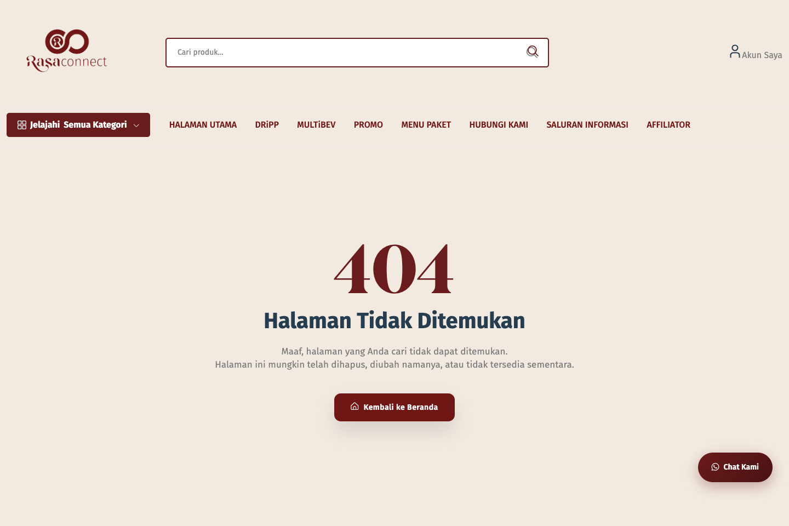
*Gambar 6.2: Tab Informasi Stok Gudang dengan Nomor Batch Fisik (Lot Serial), Tanggal Kedaluwarsa, Saldo Jubelio, dan Log Mutasi.*

1. **Tab Informasi Stok (`/admin/warehouses/{id}`)**: Menampilkan daftar produk dengan dua saldo utama:
   - **Stok Fisik WMS**: Saldo fisik barang di gudang beserta rincian nomor batch (`lot_serial`) dan tanggal kedaluwarsa (`expired_at`).
   - **Stok Jubelio**: Saldo kuota agregat yang dipublikasikan ke kanal penjualan online/marketplace.
2. **Sinkronisasi Stok WMS**: Klik tombol **[Sinkronkan Stok WMS]** untuk menarik pembaruan stok batch terbaru dari database WMS.
3. **Sinkronisasi Stok Jubelio**: Klik tombol **[Sinkronkan Stok Jubelio]** untuk menyelaraskan kuota penjualan dengan marketplace.
4. **Penyesuaian Stok Manual (Stock Adjustment)**:
   - Admin dapat menambah atau mengurangi kuantiti stok jika terjadi selisih opname fisik dengan mencantumkan alasan mutasi pada log sistem.
5. **Download Stock & Batch (Export Excel)**:
   - Mengunduh laporan stok Hub berformat spreadsheet 2 sheet:
     - Sheet 1: Ringkasan Saldo Stok per SKU.
     - Sheet 2: Rincian Lengkap per Nomor Batch dan Tanggal Kedaluwarsa.

---

## 7. MODUL ARMADA PENGIRIMAN & DRIVER INTERNAL

Menu: **Armada Pengiriman** (`/admin/armadas`)

Modul ini mengelola armada kendaraan milik Rasa Group yang diperbantukan untuk pengiriman pesanan B2B, suplai antar-hub (*inter-hub transfer*), atau pengantaran khusus ke gerai/outlet mitra.

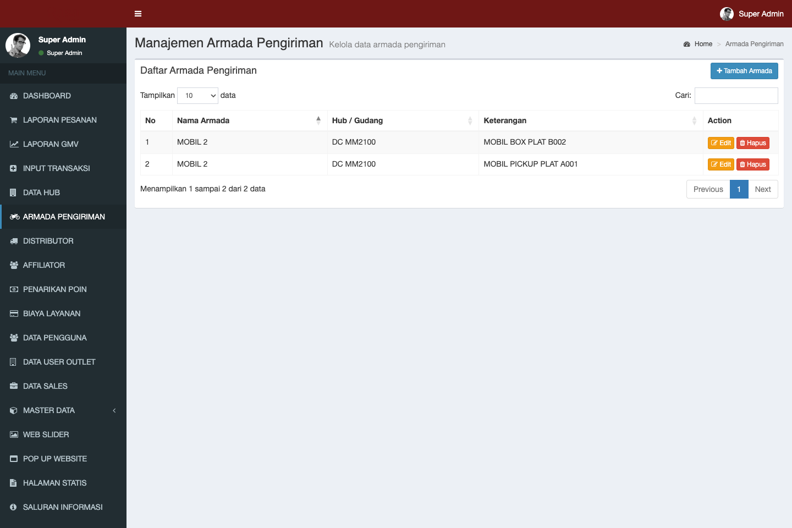
*Gambar 7.1: Daftar Armada Kendaraan Perusahaan, Nomor Polisi, Penugasan Kurir, Kapasitas Muatan, dan Status Operasional.*

### Prosedur Pengelolaan Armada:
1. **Tambah Data Armada**:
   - Masukkan Nama/Tipe Armada (misal: *Blind Van Grand Max 01*, *Truk CDD Pendingin 02*, *Motor Delivery Hub Bekasi*).
   - Masukkan Nomor Polisi / Plat Kendaraan (misal: `B 9123 KCA`).
   - Pilih Jenis Kendaraan: Roda 2 (Motor), Van, Mobil Box, Truk Engkel, atau Truk Double.
   - Masukkan Kapasitas Muatan Maksimum (Kilogram dan Volume meter kubik).
   - Tentukan Nama Driver / Sopir penanggung jawab beserta nomor telepon aktif.
2. **Status Operasional**:
   - **Tersedia (Available)**: Armada siap ditugaskan untuk pengantaran.
   - **Dalam Pengiriman (In Transit)**: Armada sedang bertugas di jalan.
   - **Perawatan / Bengkel (Maintenance)**: Armada dinonaktifkan sementara dari penugasan.

---

## 8. MODUL MANAJEMEN DISTRIBUTOR B2B

Menu: **Distributor** (`/admin/distributors`)

Mitra distributor adalah mitra dagang berskala besar yang memiliki hak distribusi wilayah dan fasilitas pembelian kredit dengan termin pembayaran (*Term of Payment* / TOP).

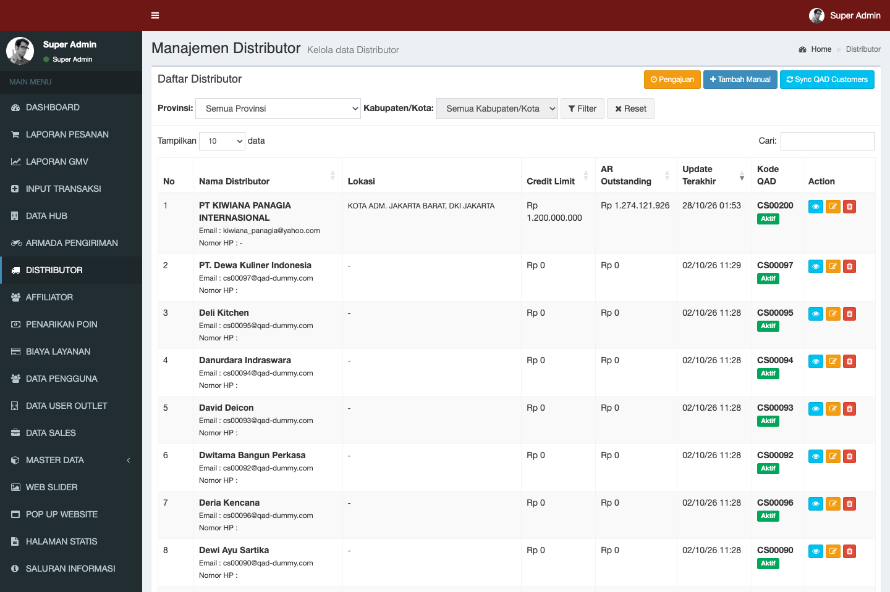
*Gambar 8.1: Daftar Mitra Distributor Resmi dengan Pengaturan Credit Limit, Termin TOP, Target Belanja, dan Diskon Kategori.*

### 8.1. Verifikasi Aplikasi Calon Distributor Baru
1. Masuk ke submenu **Aplikasi Distributor** (`/admin/distributors/applications`).
2. Buka berkas pendaftaran calon mitra.
3. Evaluasi kelengkapan berkas legalitas:
   - NIB (Nomor Induk Berusaha) & Akta Pendirian Perusahaan.
   - NPWP Perusahaan & KTP Penanggung Jawab / Direktur.
   - Foto Fasilitas Gudang & Armada Distribusi Mitra.
4. **Tindakan**:
   - Klik **Approve** untuk menerbitkan status mitra distributor aktif.
   - Klik **Reject** dengan memberikan alasan tertulis jika berkas legalitas tidak memenuhi kriteria verifikasi.

### 8.2. Konfigurasi Finansial & Limit Kredit
Buka halaman detail distributor terdaftar:
- **Plafon Limit Kredit (Credit Limit)**: Masukkan batas maksimum nilai piutang dagang (misal: Rp 500.000.000).
- **Term of Payment (TOP)**: Tentukan jangka waktu jatuh tempo pembayaran (misal: 30 hari, 45 hari, atau 60 hari).
- **Customer Code QAD ERP**: Tautkan akun distributor dengan kode pelanggan resmi di database QAD ERP (misal: `DB00012`) via tombol **[Sync QAD]**.

### 8.3. Target Belanja & Diskon Khusus Kategori
- **Target Belanja Bulanan / Tahunan (`target-belanja`)**: Menetapkan target komitmen nilai transaksi distributor per periode sebagai indikator evaluasi performa keagenan.
- **Diskon Khusus Kategori (`category-discounts`)**: Menetapkan persentase potongan harga khusus per kategori produk (contoh: Kategori Sirup mendapat diskon 15%, Kategori Topping mendapat diskon 10%).

---

## 9. MODUL KEMITRAAN AFFILIATOR (DRIIPPRENEUR & PENARIKAN POIN)

Menu: **Affiliator** (`/admin/driippreneurs`) dan **Penarikan Poin** (`/admin/point-withdrawals`)

Program DRiiPPreneur adalah ekosistem kemitraan berbasis referral bagi barista, mixologist, cafe owner, dan kreator konten F&B untuk mempromosikan produk Rasa Group dan mendapatkan komisi berupa poin reward.

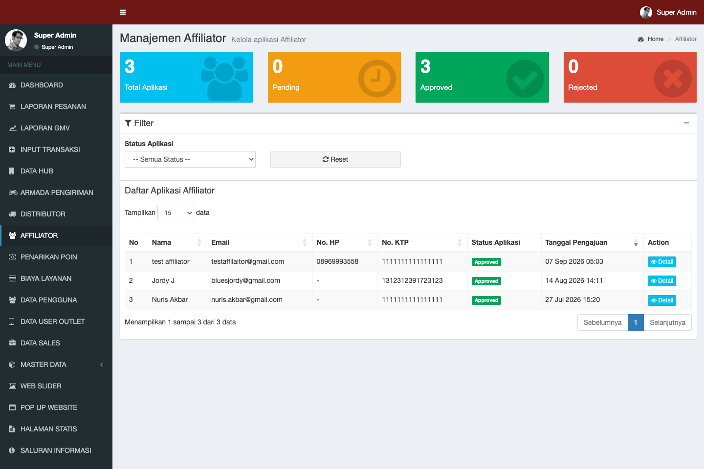
*Gambar 9.1: Pengelolaan Mitra Affiliator, Verifikasi Kelayakan (Eligibility), Kode Referral, dan Akumulasi Poin Reward.*

### 9.1. Verifikasi Kelayakan (Eligibility) Affiliator
1. Buka menu **Affiliator**.
2. Periksa profil mitra yang mengajukan diri.
3. Klik tombol **Setuju / Aktifkan Eligibility** untuk mengaktifkan kode referral unik mitra dan tautan afiliasi belanja.

### 9.2. Mekanisme Perolehan & Konversi Poin
- Setiap kali pembeli menyelesaikan transaksi pesanan (`Completed`) menggunakan kode referral atau tautan mitra, sistem secara otomatis mengkreditkan poin ke dompet digital mitra.
- Nilai konversi poin diatur secara global pada menu Pengaturan Sistem (misal: setiap omset transaksi Rp 10.000 menghasilkan 1 Poin; 1 Poin bernilai Rp 100 saat dicairkan).

### 9.3. SOP Otorisasi Penarikan Poin (Pencairan Dana ke Rekening)
Menu: **Penarikan Poin** (`/admin/point-withdrawals`)

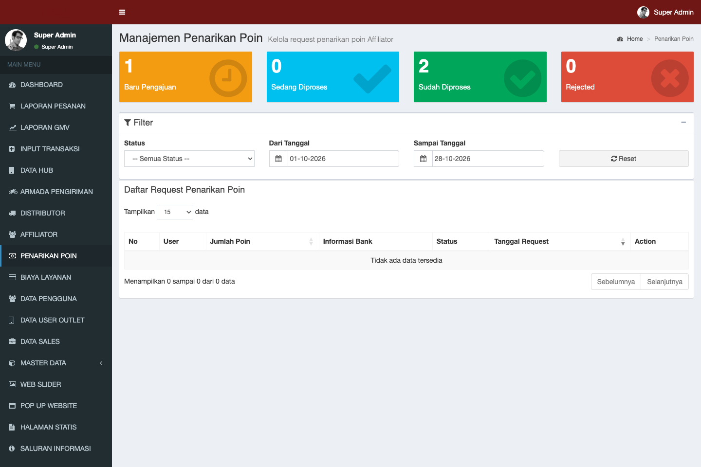
*Gambar 9.2: Daftar Permohonan Pencairan Saldo Poin ke Rekening Bank dengan Alur Approval dan Eksekusi Transfer Finansial.*

1. Tim Finance membuka daftar permohonan penarikan poin yang berstatus **Pending**.
2. Periksa detail penarikan: Nama Mitra, Jumlah Poin yang Ditukar, Nominal Rupiah, Nama Bank, Nomor Rekening, dan Nama Pemilik Rekening.
3. **Langkah Eksekusi Finansial**:
   - Klik tombol **Approve**: Menyatakan bahwa permohonan telah diverifikasi dan masuk dalam antrean pencairan kas/bank.
   - Lakukan transfer dana dari rekening operasional perusahaan ke rekening bank mitra.
   - Klik tombol **Complete**: Menandai transaksi telah berhasil ditransfer. Saldo poin mitra resmi terpotong permanen.
   - *Penolakan (Reject)*: Jika nomor rekening tidak valid atau nama pemilik rekening tidak sesuai, klik **Reject** dengan mencantumkan alasan. Saldo poin akan dikembalikan secara utuh ke akun mitra.

---

## 10. MODUL BIAYA LAYANAN PEMBAYARAN (PAYMENT FEES)

Menu: **Biaya Layanan** (`/admin/payment-fees`)

Modul ini dikelola oleh Tim Finance untuk mengatur biaya transaksi (*Merchant Discount Rate* / MDR) yang dikenakan oleh penyedia Payment Gateway (Faspay) untuk setiap metode pembayaran.

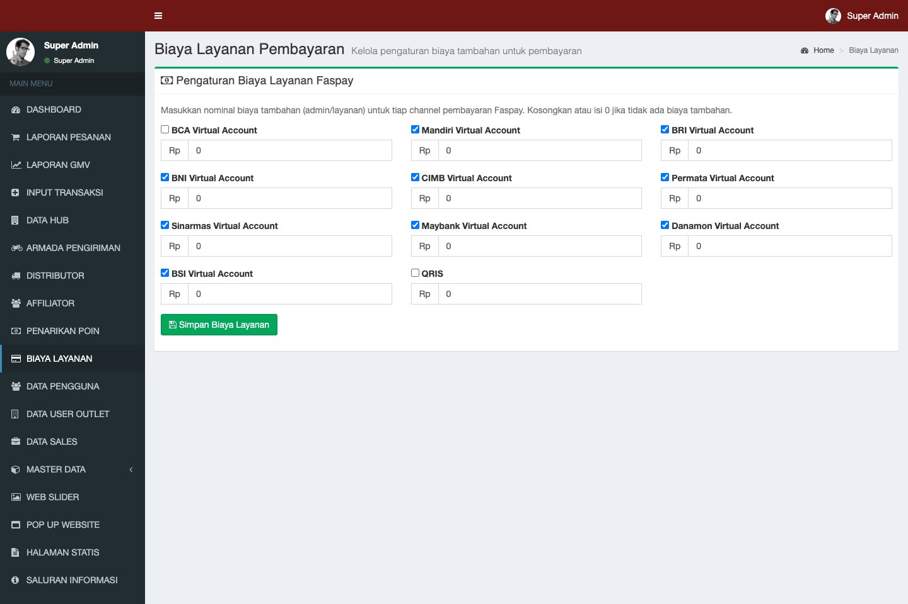
*Gambar 10.1: Konfigurasi Biaya Layanan Transaksi per Kanal Pembayaran (VA, QRIS, Kartu Kredit) dan Kebijakan Pembebanan Biaya.*

### Komponen Pengaturan Fee:
1. **Metode Pembayaran**: Virtual Account Bank (BCA, Mandiri, BRI, BNI, Permata), QRIS, E-Wallet, dan Kartu Kredit.
2. **Skema Perhitungan Fee**:
   - **Nominal Tetap (Fixed Fee)**: Biaya bernilai rupiah pasti per transaksi (misal: Rp 4.000 per transaksi Virtual Account).
   - **Persentase (Percentage Fee)**: Biaya dihitung dari persentase nilai transaksi (misal: 0.7% untuk QRIS, 2.5% untuk Kartu Kredit).
3. **Kebijakan Pembebanan Biaya**:
   - **Dibebankan ke Pelanggan (*Customer Paid*)**: Nilai fee otomatis ditambahkan ke total tagihan saat checkout.
   - **Ditanggung Perusahaan (*Company Absorbed*)**: Pelanggan membayar murni harga barang dan ongkir, fee dipotong dari penerimaan bersih perusahaan.

---

## 11. MODUL DATA PENGGUNA & OUTLET (USER MANAGEMENT)

Menu: **Data Pengguna** (`/admin/users`) dan **Data User Outlet** (`/admin/outlets`)

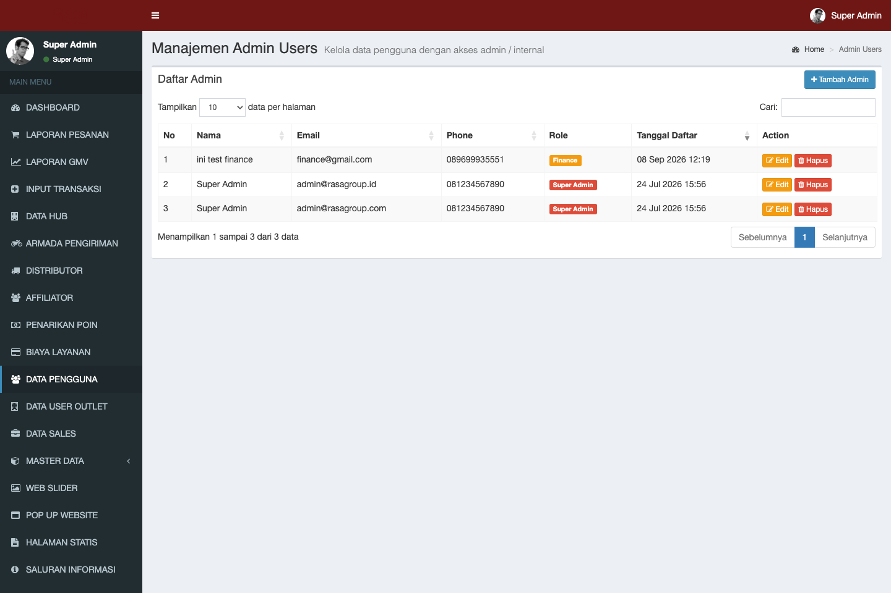
*Gambar 11.1: Daftar Pengguna Sistem, Filter Peran (Role), Reset Password, dan Status Verifikasi Kontak WhatsApp.*

### 11.1. Tata Kelola Data Pengguna (Users)
- **Kategori Peran Pengguna (User Roles)**:
  - *Customer Roles*: `buyer` (ritel umum), `reseller` (toko/agen kecil), `distributor` (grosir B2B), `driippreneur` (affiliator).
  - *Internal Staff Roles*: `super_admin`, `finance`, `ecommerce`, `sales_admin`, `sales`, `warehouse`, `brand_marketing`, `it_application`.
- **Fungsi Administrasi**:
  - Menambah user admin baru dan menetapkan role hak akses.
  - Reset kata sandi (*Password Reset*) jika pengguna terkendala login.
  - Memeriksa status verifikasi nomor WhatsApp pengguna.
  - Mengaktifkan atau menonaktifkan (*Suspend*) akun pengguna bermasalah.

### 11.2. Pengelolaan Cabang Outlet Pelanggan (Outlets)
- Digunakan untuk memetakan jaringan gerai/cabang fisik milik satu entitas pelanggan bisnis (misal: Cafe A Cabang Senopati, Cafe A Cabang Kemang).
- Memungkinkan pelanggan B2B memiliki satu akun utama penagihan namun dapat memilih lokasi pengiriman yang berbeda pada masing-masing cabang outletnya.

---

## 12. MODUL MANAJEMEN TIM SALES (SALESPERSON MANAGEMENT)

Menu: **Data Sales** (`/admin/sales`)

Modul ini mendokumentasikan seluruh tenaga pemasar resmi (wiraniaga) Rasa Group untuk pencatatan komisi dan monitoring target penjualan.

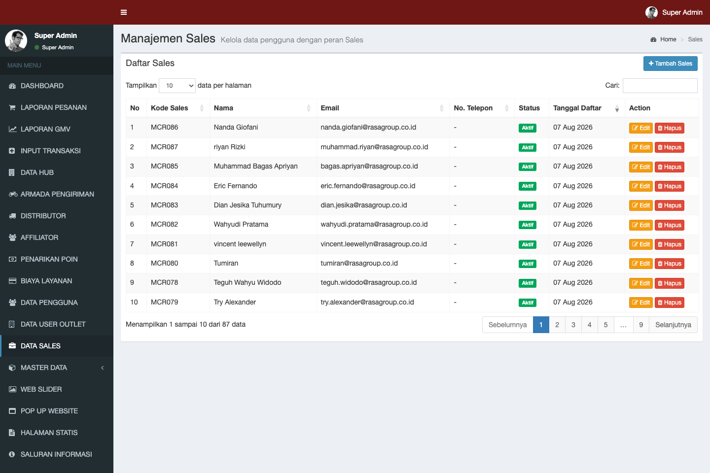
*Gambar 12.1: Daftar Wiraniaga Resmi, Kode Sales Unik, Coverage Area, dan Riwayat Transaksi Atribusi Penjualan.*

### Tata Cara Pengelolaan:
1. **Tambah Master Sales**:
   - Masukkan Nama Salesperson, Nomor WhatsApp/Telepon, Wilayah Binaan (Coverage Area), dan **Kode Sales Unik** (misal: `SLS001`, `MCR001`).
2. **Atribusi Penjualan**:
   - Setiap transaksi yang mencantumkan kode sales (baik dimasukkan oleh pembeli online saat checkout maupun diinput manual via form order admin) secara otomatis terikat pada akun sales bersangkutan.
3. **Monitoring Order & Performa**:
   - Klik tombol **[Pesanan]** pada baris profil sales untuk melihat seluruh riwayat order, status pembayaran, serta total omset GMV yang berhasil dibukukan oleh sales tersebut.

---

## 13. MODUL MASTER DATA KATALOG PRODUK & HARGA

Menu induk: **Master Data**

```
Master Data
 ├── Produk (/admin/products)
 ├── Brand (/admin/brands)
 ├── Kategori (/admin/categories)
 ├── Level Harga (/admin/price-levels)
 └── Menu (/admin/menus)
Tambahan Terkait:
 ├── Potongan Harga / Tier (/admin/discount-tiers)
 └── Voucher Promo (/admin/promos)
```

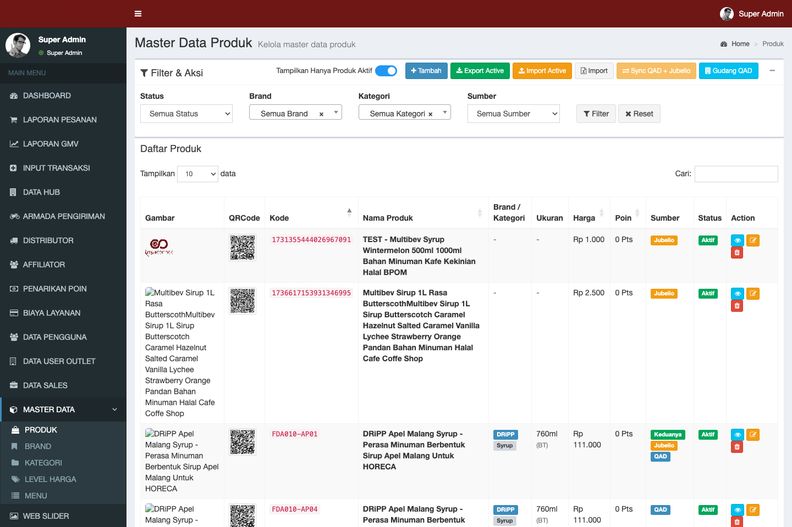
*Gambar 13.1: Master Katalog Produk dengan SKU, Brand, Kategori, Berat/Dimensi Logistik, Harga Ritel, dan Sinkronisasi Massal.*

### 13.1. Master Produk (`/admin/products`)
- **Informasi Inti**: Nama Produk, Kode Produk / SKU, Brand, Kategori, Deskripsi, Komposisi, Saran Penyajian.
- **Data Fisik (Sangat Kritikal untuk Ekspedisi)**:
  - **Berat Produk (gram)**: Wajib diisi sesuai berat kotor paket. Jika bernilai 0, sistem ekspedisi tidak dapat menghitung ongkir dan booking kurir akan gagal.
  - **Dimensi (P x L x T dalam cm)**: Digunakan kurir untuk menghitung berat volumetrik kargo.
- **Harga Produk**: Harga Katalog Ritel, Harga Dasar Pokok (HPP).
- **Galeri Gambar**: Unggah foto produk utama beresolusi tinggi dengan latar belakang bersih.
- **Sinkronisasi Massal**:
  - **Export / Import Active**: Unduh dan perbarui data produk massal via spreadsheet Excel.
  - **Sync QID & Sync Jubelio**: Menyelaraskan SKU produk dan barcode ke sistem induk ERP.

### 13.2. Brand & Kategori Produk
- **Brand (`/admin/brands`)**: Mengelompokkan produk berdasarkan merek dagang resmi (contoh: *DRiiPP Flavour*, dll).
- **Kategori (`/admin/categories`)**: Struktur klasifikasi produk (contoh: *Syrup*, *Powder*, *Sauce*, *Tea*, *Topping*).

### 13.3. Level Harga & Diskon Bertingkat

*Gambar 13.2: Skema Diskon Bertingkat (Tiering Cart) Berdasarkan Jumlah Pembelian Satuan Pack dan Kartonan.*

- **Level Harga (`/admin/price-levels`)**: Menetapkan harga khusus untuk kelompok pelanggan tertentu (misal: Harga Reseller Silver, Harga Reseller Gold, Harga Khusus Cafe Chain).
- **Potongan Harga Bertingkat / Tiering (`/admin/discount-tiers`)**: Skema diskon otomatis saat kuantiti tertentu terpenuhi (contoh: Pembelian 6 s/d 11 botol diskon 5%; Pembelian $\ge 12$ botol / 1 karton diskon 12%).
- **Voucher Promo (`/admin/promos`)**: Membuat kode kupon promosi belanja (contoh: `RASAHEMAT20`) dengan opsi diskon persentase atau nominal rupiah, masa kedaluwarsa kupon, kuota penggunaan, dan syarat minimum belanja.

---

## 14. MODUL KONTEN WEBSITE & PEMASARAN (CMS)

Modul ini dikelola oleh Tim Brand Marketing untuk memperbarui tampilan visual dan informasi storefront RasaConnect.

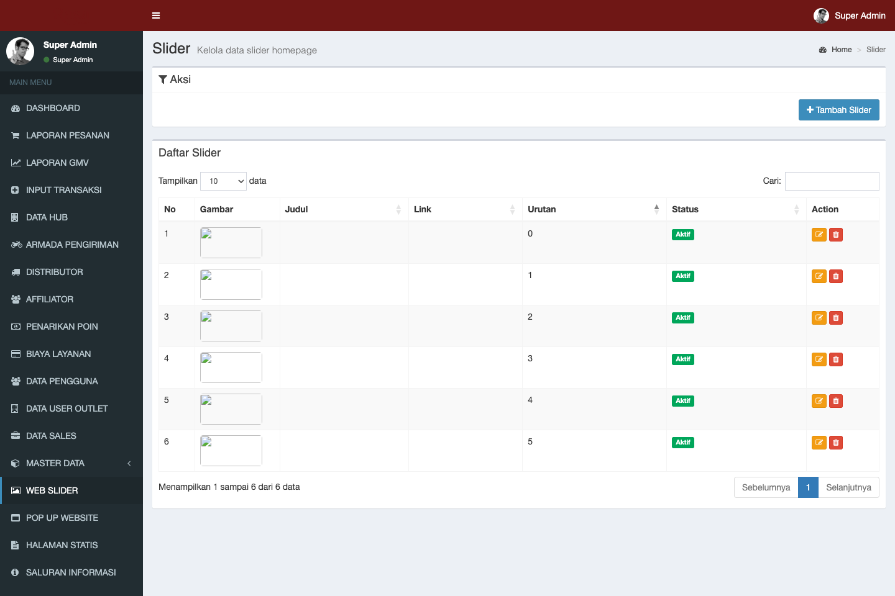
*Gambar 14.1: Daftar Web Slider Promosi Storefront, Tautan Tujuan Kampanye, dan Pengaturan Urutan Prioritas Tampil.*

### 14.1. Web Slider (`/admin/sliders`)
- Banner beranda dinamis yang tampil di bagian atas halaman web.
- Masukkan judul banner, unggah berkas gambar berukuran presisi (desktop & mobile banner), tentukan URL tautan tujuan promo, dan atur nomor urutan tampil (*sorting order*).

### 14.2. Pop-Up Website (`/admin/website-popups`)
- Banner modal promosi yang muncul secara otomatis saat pengunjung pertama kali membuka situs RasaConnect.
- Atur gambar pop-up, link promo, serta opsi pengaktifan/penonaktifan instan.

### 14.3. Halaman Statis CMS (`/admin/pages`)
- Mengedit isi konten halaman hukum dan informasi perusahaan: *Tentang Kami*, *Syarat & Ketentuan Pembelian*, *Kebijakan Privasi*, dan *Panduan Belanja*.

### 14.4. Saluran Informasi & Menu Navigasi
- **Saluran Informasi (`/admin/information-channels`)**: Mempublikasikan artikel panduan mixology, tren minuman terkini, liputan kegiatan pameran, atau pengumuman hari libur operasional hub.
- **Menu Navigasi (`/admin/menus`)**: Mengatur urutan tombol dan tautan pada bilah navigasi utama (*Header Menu*) dan bagian bawah situs (*Footer Menu*).

---

## 15. MODUL PENGATURAN SISTEM TERPUSAT (SETTINGS)

Menu: **Pengaturan** (`/admin/settings`)

Akses terbatas khusus **Super Admin** dan **IT Application Support**.

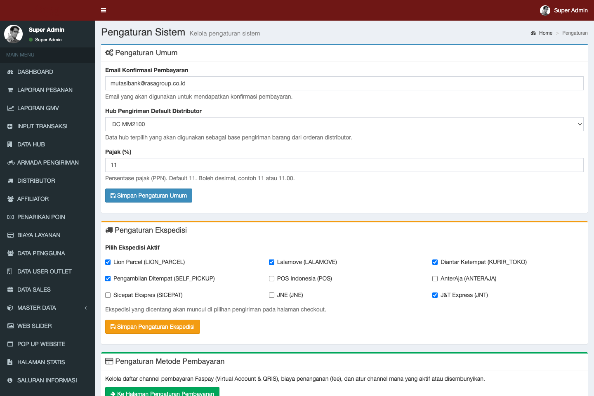
*Gambar 15.1: Panel Pengaturan Identitas Perusahaan, Tarif PPN 11%, Rasio Poin Loyalitas, dan Aktivasi Layanan Ekspedisi.*

### 15.1. Tab Pengaturan Umum (General Settings)
- **Nama Perusahaan / Portal**: Rasa Group / RasaConnect.
- **Kontak Perusahaan**: Nomor WhatsApp Official, Hotline CS, Email Dukungan.
- **Alamat Kantor Pusat**: Alamat domisili legal perusahaan.
- **Pajak Pertambahan Nilai (PPN)**: Konfigurasi persentase tarif PPN resmi (default: 11%).

### 15.2. Tab Rasio Poin DRiiPPreneur
- **Belanja ke Poin**: Nilai nominal belanja yang menghasilkan 1 poin reward (contoh: Rp 10.000).
- **Poin ke Rupiah**: Nilai konversi rupiah per 1 poin saat affiliator mencairkan saldo (contoh: 1 Poin = Rp 100).

### 15.3. Tab Pengaturan Layanan Ekspedisi
- Mengaktifkan atau menonaktifkan mitra kurir yang tampil pada halaman checkout pembeli (J&T Express, Lion Parcel, JNE, Lalamove, SiCepat, dll).
- Konfigurasi kredensial API partner, URL endpoint (Sandbox/Production), serta penetapan Hub Asal default jika sistem tidak menemukan alokasi gudang terdekat.

---

## 16. MATRIKS INTEGRASI SISTEM EKSTERNAL

Portal RasaConnect terhubung dengan 6 (enam) ekosistem teknologi eksternal:

| Nama Sistem Eksternal | Peran & Ruang Lingkup Data | Metode Integrasi | Tindakan / Eksekusi di Admin |
| :--- | :--- | :--- | :--- |
| **QAD ERP** | Pencatatan Sales Order B2B, master customer code distributor, kontrol holding induk. | REST API Backend | Tombol **[Sinkron QAD]** pada detail pesanan distributor. |
| **Jubelio Omnichannel** | Sinkronisasi total kuota stok agregat ke marketplace online (Shopee, Tokopedia, TikTok, Web). | REST API Token | Tombol **[Sinkron Jubelio]** pada pesanan & **[Sinkronkan Stok Jubelio]** di modul Hub. |
| **Zoho Books** | Pembukuan akuntansi korporat (Sales Order, Invoice, Customer Payment, PPN, dan diskon level transaksi). | OAuth 2.0 API | Tombol **[Sinkron Zoho]** pada detail pesanan; otomatis memetakan `location_id` hub pengirim. |
| **WMS Pergudangan** | Pemrosesan picking & packing fisik berbasis nomor batch (*lot serial*) dan masa kedaluwarsa (*FEFO*). | WMS API Gateway | Tombol **[Kirim ke WMS]** pada detail order & **[Sinkronkan Stok WMS]** di modul Hub. |
| **Payment Gateway (Faspay)** | Otomatisasi verifikasi pembayaran Virtual Account, QRIS, E-Wallet, dan Kartu Kredit. | Webhook Callback | Otomatis 100% tanpa campur tangan admin saat dana diterima sistem perbankan. |
| **EkspedisiKu & J&T Logistik** | Pengecekan ongkos kirim real-time, penerbitan nomor resi resmi (AWB), booking kurir, dan live tracking. | Courier API Aggregator | Tombol **[Buat Booking]**, **[Request Pickup]**, dan **[Lacak Resi]** pada detail order. |

---

## 17. PANDUAN PENANGANAN MASALAH (TROUBLESHOOTING & FAQ)

### Q1: Mengapa formulir status pesanan di sebelah kanan terkunci dan tidak bisa diubah?
> **Penyebab:** Sistem menerapkan pengaman otomatis (*safety lock*). Pesanan yang belum lunas atau pesanan TOP distributor yang belum disetujui Finance secara otomatis mengunci dropdown status agar barang tidak dikeluarkan sebelum kepastian pembayaran aman.  
> **Solusi:** Pastikan pembayaran pelanggan via gateway telah terkonfirmasi lunas (*Paid*) atau minta otorisasi Tim Finance untuk menyetujui transaksi (*Approve Finance* khusus pesanan Distributor TOP).

---

### Q2: Saat mengklik "Buat Booking" EkspedisiKu, muncul pesan error merah di bawah tombol. Bagaimana solusinya?
> **Penyebab:** Umumnya disebabkan oleh kelengkapan data alamat pengiriman penerima atau pengirim (misal: kode pos tidak valid, nomor handphone kurang digit, atau berat produk pada master item bernilai 0 gram).  
> **Solusi:**
> 1. Periksa kelengkapan alamat penerima pada kartu Informasi Pengiriman.
> 2. Buka Master Data Produk dan pastikan berat produk (`weight`) telah terisi (minimal 1 gram).
> 3. Jika pesan bertuliskan API timeout, tunggu 1-2 menit lalu klik tombol kembali.

---

### Q3: Riwayat sinkronisasi QAD bertanda merah (Failed). Apa yang harus dilakukan?
> **Penyebab:** Server QAD ERP menolak format data (misal: masa berlaku kredit distributor habis, kode item belum terdaftar di QAD, atau customer code tidak ditemukan).  
> **Solusi:**
> 1. Klik tautan *[Lihat Detail JSON Payload & Response]* pada tabel Riwayat Sinkronisasi QAD.
> 2. Periksa baris respons penolakan API.
> 3. Lakukan koreksi data master distributor atau item terkait.
> 4. Klik tombol **[Sinkron QAD]** untuk mengirim ulang payload perbaikan.

---

### Q4: Mengapa sistem Jubelio tidak menampilkan rincian nomor batch dan tanggal expired seperti WMS?
> **Penyebab:** Secara arsitektur, Jubelio berfungsi sebagai *Omnichannel Inventory Hub* untuk menyinkronkan total kuota jual agregat ke marketplace dan tidak mencatat struktur lot batch.  
> **Solusi:** Rincian nomor batch fisik (`lot_serial`) dan tanggal kedaluwarsa (`expired_at`) dikelola secara resmi oleh modul **WMS / QAD ERP**. Admin dapat melihat rincian batch langsung di menu **Data Hub &rarr; Detail Hub &rarr; Tab Informasi Stok** atau mengunduh laporan via tombol **Download Stock & Batch**.

---

### Q5: Nilai Gross GMV berbeda dengan Realized Revenue pada Laporan GMV. Apakah terjadi selisih?
> **Penjelasan:** Hal ini merupakan karakteristik wajar dalam akuntansi e-commerce:
> - **Gross GMV** mencatat seluruh komitmen nilai produk yang dipesan pembeli (termasuk pesanan yang masih menunggu pembayaran atau berstatus tempo TOP).
> - **Realized Revenue** hanya mencatat nilai dari pesanan yang uangnya telah riil masuk/lunas (*Paid*).  
> Selisih di antara keduanya disebabkan oleh potongan diskon promo, pesanan yang masih pending, serta komponen ongkos kirim dan pajak.

---

## 18. GLOSARIUM STATUS & INDIKATOR SISTEM

| Istilah / Status | Kategori | Penjelasan & Makna Sistem |
| :--- | :--- | :--- |
| **Pending** | Status Pesanan | Transaksi baru dibuat, menunggu penyelesaian pembayaran atau evaluasi limit kredit. |
| **Processing** | Status Pesanan | Pembayaran telah terkonfirmasi aman. Barang sedang dikemas atau disiapkan di WMS. |
| **Shipped** | Status Pesanan | Barang telah memiliki nomor resi kurir valid atau telah diserahkan di gudang. |
| **Delivered** | Status Pesanan | Kurir melaporkan bahwa barang telah sampai di alamat tujuan penerima. |
| **Completed** | Status Pesanan | Transaksi tuntas sempurna. Hak poin reward telah masuk ke saldo mitra distributor/affiliator. |
| **Cancelled** | Status Pesanan | Pesanan dibatalkan permanen; stok inventori dan limit kredit dikembalikan utuh. |
| **Paid** | Status Pembayaran | Pembayaran telah lunas terverifikasi otomatis melalui Payment Gateway Faspay. |
| **Term of Payment** | Status Pembayaran | Skema transaksi kredit berjangka (tempo) khusus mitra distributor terverifikasi. |
| **Finance Approval: 1** | Otorisasi | Transaksi kredit TOP telah disetujui resmi oleh Finance dan dilepaskan ke operasional hub. |
| **Finance Approval: 0** | Otorisasi | Transaksi kredit TOP masih tertahan, menunggu evaluasi kelayakan kredit dari tim Finance. |
| **AR Outstanding** | Finansial | *Account Receivable* — total tagihan piutang distributor yang saat ini masih belum dilunasi. |
| **Gross GMV** | Finansial | Total nilai kotor produk yang dipesan sebelum dikurangi diskon, biaya layanan, dan ongkir. |
| **Net Merchandise Value** | Finansial | Nilai bersih penjualan barang setelah dikurangi seluruh potongan diskon dan kupon promo. |
| **Realized Revenue** | Finansial | Total penerimaan uang riil yang sudah terkonfirmasi masuk ke kas/bank perusahaan. |
| **AOV** | Finansial | *Average Order Value* — nilai rata-rata rupiah per transaksi pesanan. |
| **FEFO** | Inventori | *First Expired, First Out* — mekanisme pengambilan stok barang di gudang yang memprioritaskan batch dengan tanggal kedaluwarsa paling awal. |
| **Lot Serial / Batch** | Inventori | Nomor identitas produksi unik pabrik yang terikat pada kuantiti fisik barang dan tanggal kedaluwarsa. |
| **Stok Jubelio** | Omnichannel | Saldo kuota inventori terintegrasi per SKU yang dipublikasikan ke kanal penjualan online/marketplace. |
| **EkspedisiKu** | Logistik | Layanan integrasi multikurir agregator (Lion Parcel, JNE, SiCepat) dengan fitur otomatisasi AWB. |
| **Self-Pickup** | Logistik | Metode pengambilan mandiri barang oleh pembeli/kurir pembeli langsung di gudang Hub Rasa Group. |

---
*Buku Panduan Operasional Admin ini dikelola secara berkala oleh Tim Product & Teknologi Rasa Group. Untuk eskalasi kendala sistem, hubungi IT Helpdesk Rasa Group.*
