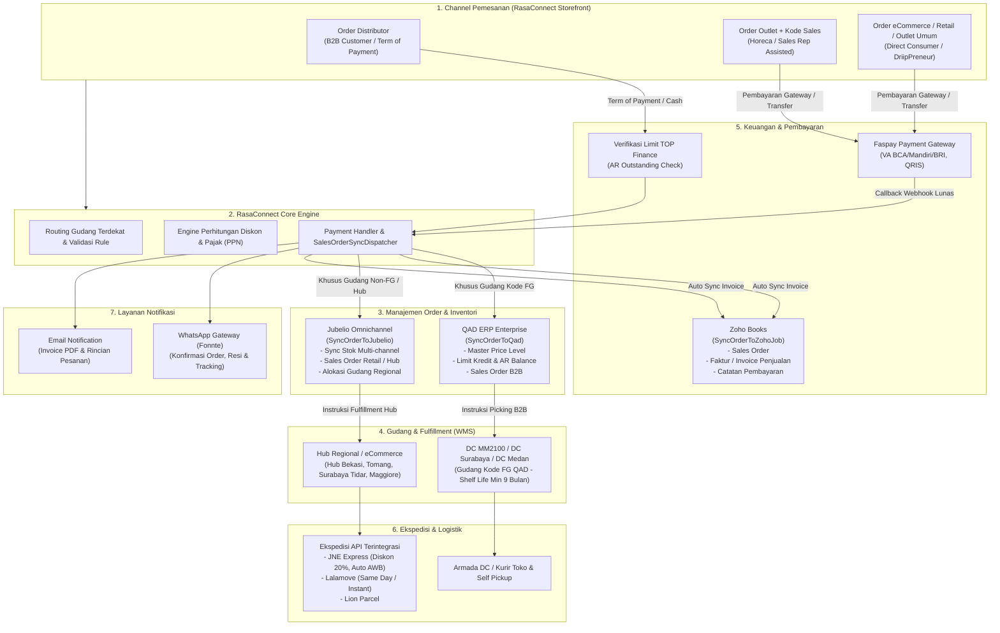

# Alur Sumber Pengiriman Gudang & Perhitungan Diskon Pembelian

Dokumen ini menjelaskan alur penentuan lokasi asal pengiriman barang (Gudang/Hub/DC), ketersediaan ekspedisi berdasarkan peran pengguna (role), serta skema perhitungan diskon pembelian secara menyeluruh pada sistem e-commerce Rasa Connect.

---

## BAGIAN I: ALUR SUMBER PENGIRIMAN GUDANG & EKSPEDISI

### 1. Aturan Khusus (Prioritas Utama)
Sistem memiliki satu aturan mutlak yang mengabaikan semua aturan tipe pengguna:
- **Kondisi:** Jika **Total Belanja (Subtotal) ≥ Rp 25.000.000**.
- **Sumber Pengiriman:** Otomatis dikirim dari Gudang Utama Pusat, yaitu **DC MM2100**.

---

### 2. Aturan Berdasarkan Tipe Pengguna (Role)
Jika total belanja < Rp 25.000.000, maka pengiriman ditentukan oleh peran akun pemesan dengan pembagian sebagai berikut:

#### A. Distributor
- **Kondisi:** Pesanan dilakukan oleh akun dengan role **Distributor**.
- **Gudang Sumber:** Sistem akan mencarikan gudang terdekat dari daftar gudang **Target Role: Distributor**.
- **Opsi Ekspedisi:**
  - **Kurir Toko** (Diantar Ketempat)
  - **Self Pickup** (Ambil Sendiri di Gudang)
- **Tujuan Sinkronisasi Order:** Dikirim ke **QAD** (ERP) dan diteruskan ke **WMS** (Warehouse Management System). *(Tidak disinkronisasi ke Jubelio)*.
- **Daftar Gudang Aktif:**
  - **DC MM2100** (`WHMPRG001`)
  - **DC Surabaya** (`WHSBY001`)
  - **DC Medan** (`WHMDN01`)

#### B. Outlet (Dengan Kode Sales)
- **Kondisi:** Pesanan dilakukan oleh akun **Outlet** dan akun tersebut **memiliki/memasukkan Kode Sales**.
- **Gudang Sumber:** Sistem akan mencarikan gudang terdekat dari daftar gudang **Target Role: Outlet**.
- **Opsi Ekspedisi:**
  - **Lion Parcel**
  - **Self Pickup**
  - **Kurir Toko** *(Khusus jika alamat pengiriman berada di area Jabodetabek)*
- **Tujuan Sinkronisasi Order:** Dikirim ke **Jubelio** dan diteruskan ke **WMS**. *(Tidak dikirim ke QAD)*.
- **Daftar Gudang Aktif:**
  - **Hub Bekasi** (`WHRG002`)
  - **Hub Surabaya Tidar** (`WHMPSBY`)
  - **Hub Maggiore** (`WHMPRG003`)

#### C. Outlet / Pembeli Umum (Tanpa Kode Sales / eCommerce Biasa)
- **Kondisi:** Pesanan dilakukan oleh akun **Outlet** atau **Pembeli Umum**, dan **TIDAK memakai Kode Sales**.
- **Gudang Sumber:** Sistem akan mencarikan gudang terdekat dari daftar gudang **Target Role: eCommerce**.
- **Opsi Ekspedisi:**
  - Semua layanan ekspedisi umum aktif via API (misal: **JNE**, **Lalamove**)
  - **Kurir Toko**
  - *(Self Pickup **TIDAK** tersedia)*
- **Tujuan Sinkronisasi Order:** Dikirim ke **Jubelio** dan diteruskan ke **WMS**. *(Tidak dikirim ke QAD)*.
- **Daftar Gudang Aktif:**
  - **Ecommarce Tomang** (`WHECOMM1`)
  - **Hub Surabaya Tidar** (`WHMPSBY`)

---

### 3. Prioritas Pencarian Gudang Terdekat
Setelah sistem mengelompokkan gudang sesuai tipe pengguna di atas, penentuan 1 gudang spesifik dilakukan berdasarkan urutan prioritas geografis:
1. **Titik Koordinat (Latitude / Longitude):** Dicari gudang yang jarak titik koordinatnya paling dekat dengan titik koordinat alamat pengiriman.
2. **Kecamatan (District):** Jika titik koordinat tidak ditemukan, mencari gudang di Kecamatan yang sama.
3. **Kota / Kabupaten (Regency):** Jika belum ditemukan, mencari gudang di Kota/Kabupaten yang sama.
4. **Provinsi (Province):** Jika belum ditemukan, mencari gudang di Provinsi yang sama.
5. **Fallback:** Jika tetap tidak ada yang satu daerah, sistem memilih gudang aktif sesuai rolenya dengan prioritas default ke **DC MM2100**.

---

## BAGIAN II: PERHITUNGAN DISKON KETIKA PEMBELIAN

Sistem e-commerce menerapkan skema diskon bertingkat yang dihitung secara otomatis saat checkout berdasarkan kategori produk, volume pembelian, dan role pengguna.

### 1. Diskon Level Produk (Promo Katalog)
- Jika produk memiliki potongan promo langsung dari harga aslinya, harga satuan yang masuk ke keranjang belanja otomatis menggunakan harga promo aktif (`final_price`).
- Pada tampilan katalog, sistem memperlihatkan harga coret dan harga promo.

---

### 2. Diskon Berjenjang Kategori Produk (Tiered Category Discount)
Skema diskon ini berlaku bagi pembeli bertipe **Outlet** dan **Subdist / Reseller** (Non-Distributor).

#### A. Pembagian Grup Kategori Produk
Produk dikelompokkan ke dalam 2 grup kategori:
1. **Grup 1: Syrup & Sauce**
   - Kategori: `Syrup` dan `SAUCE`.
2. **Grup 2: Powder, Pulp & Lainnya**
   - Kategori: `PULP`, `POWDER`, `COCOA`, `PUREE`, `TEA`, `TOPPING`, `JELLY`, `RAMOE`.

#### B. Konversi Volume ke Satuan Karton
Akumulasi kuantitas produk dalam satu grup dikonversikan ke satuan karton (1 karton = 6 pcs):
- **Jumlah Karton** = Total botol/pack per grup dibagi 6, lalu dibulatkan ke bawah.
- Contoh: Membeli 8 botol Syrup dihitung sebagai **1 karton** (sisa 2 botol di bawah 1 karton tidak masuk perhitungan tier karton berikutnya).

#### C. Tabel Persentase Diskon Berjenjang

| Role Pembeli | Akumulasi Pembelian per Grup | Diskon Syrup & Sauce | Diskon Powder, Pulp & Lainnya |
| :--- | :--- | :---: | :---: |
| **Outlet** *(Default)* | **1 – 2 Karton** (6 – 17 pcs) | **2.5%** | **2.0%** |
| **Outlet** *(Default)* | **3 – 8 Karton** (18 – 53 pcs) | **5.0%** | **4.0%** |
| **Outlet** *(Default)* | **9 – 18 Karton** (54 – 113 pcs) | **7.5%** | **5.0%** |
| **Outlet** *(Default)* | **≥ 19 Karton** (≥ 114 pcs) | **10.0%** | **6.0%** |
| **Subdist / Reseller** | **> 50 Karton** (> 300 pcs) | **15.0%** | **8.0%** |

#### D. Perhitungan Nilai Potongan Diskon
- **Diskon per Grup** = Subtotal belanja pada grup tersebut dikalikan persentase diskon grup yang tercapai.
- **Total Diskon Berjenjang** = Diskon Grup 1 (Syrup & Sauce) + Diskon Grup 2 (Powder, Pulp & Lainnya).

---

### 3. Diskon Khusus Role Distributor
Akun bertipe **Distributor** menggunakan struktur harga net B2B khusus yang terhubung dengan ERP QAD:
- Distributor tidak menggunakan skema diskon berjenjang retail di atas.
- Harga produk mengacu pada master **Price Level** dan/atau **Diskon Kategori Distributor** yang ditetapkan untuk akun distributor tersebut.
- Selisih antara harga katalog sebelum PPN dengan harga net distributor ditampilkan sebagai **Diskon Distributor** pada rincian ringkasan belanja.

---

### 4. Diskon Ongkos Kirim (Shipping Discount)
- **Ekspedisi JNE:** Pesanan yang memilih pengiriman JNE otomatis memperoleh potongan ongkir sebesar **20%** dari tarif normal ekspedisi.

---

### 5. Urutan Perhitungan Total Pembayaran Saat Checkout

Alur perhitungan nilai akhir pesanan dari awal hingga pembayaran adalah:

1. **Subtotal Produk:** Total harga satuan produk dikalikan kuantitas masing-masing item.
2. **Potongan Diskon:** Total diskon berjenjang (atau diskon distributor) dikurangkan dari subtotal produk.
3. **DPP (Dasar Pengenaan Pajak):** Nilai subtotal bersih setelah dikurangi potongan diskon.
4. **PPN:** Dihitung dari nilai DPP (jika profil akun atau perusahaan diatur kena PPN). Jika akun non-PPN, nilai PPN adalah Rp 0.
5. **Ongkos Kirim:** Biaya pengiriman sesuai ekspedisi yang dipilih (sudah termasuk potongan diskon 20% jika memakai JNE).
6. **Biaya Pembayaran (Payment Fee):** Biaya admin gateway pembayaran (misal Virtual Account atau QRIS, jika ada).
7. **Total Pembayaran:** **DPP + PPN + Ongkos Kirim + Biaya Pembayaran**.

---

## BAGIAN III: DIAGRAM ARSITEKTUR & DISTRIBUSI DATA SISTEM

Bagian ini memetakan bagaimana data pesanan dari platform **RasaConnect** didistribusikan ke berbagai sistem terintegrasi (ERP, Omnichannel, Pembayaran, Logistik, dan Notifikasi) berdasarkan tipe pesanan dan peran pengguna (*role*).

### 1. Diagram Arsitektur Sistem (Flowchart Integrasi)

---

### 2. Matriks Alur Distribusi Data Berdasarkan Peran (Role)

Tabel berikut merangkum tujuan pengiriman data untuk setiap peran pengguna di RasaConnect:

| Komponen / Tujuan Data | Order Distributor (B2B) | Order Outlet (Dengan Sales) | Order eCommerce & Retail Umum |
| :--- | :--- | :--- | :--- |
| **Sistem ERP / Order** | **QAD ERP** (`SyncOrderToQad`) | **Jubelio Omnichannel** (`SyncOrderToJubelio`) | **Jubelio Omnichannel** (`SyncOrderToJubelio`) |
| **Gudang Pemenuhan** | DC MM2100, DC Surabaya, DC Medan (Gudang Kode `FG`) | Hub Bekasi, Hub Surabaya Tidar, Hub Maggiore | Ecommarce Tomang, Hub Surabaya Tidar |
| **Pencatatan Keuangan** | **Zoho Books** (Sales Order & Invoice Penjualan) | **Zoho Books** (Sales Order, Invoice & Payment) | **Zoho Books** (Sales Order, Invoice & Payment) |
| **Gateway Pembayaran** | - *Term of Payment (TOP)* berbasis limit AR QAD - Transfer Bank / Faspay | Faspay (Virtual Account BCA/Mandiri/BRI, QRIS) | Faspay (Virtual Account BCA/Mandiri/BRI, QRIS) |
| **Logistik & Ekspedisi** | Kurir Toko (Armada DC) & Self Pickup di Gudang | Lion Parcel, Kurir Toko Jabodetabek, Self Pickup | JNE Express (API - Diskon 20%), Lalamove (API), Kurir Toko |
| **Sistem WMS (Gudang)** | WMS DC (Pengecekan *Shelf Life* batch minimal 9 bulan) | WMS Hub Regional (Picking & Dispatching) | WMS Hub Regional (Packing ekspedisi & scan resi) |
| **Notifikasi Pelanggan** | WhatsApp Gateway & Email Konfirmasi Order | WhatsApp Gateway & Email Notifikasi | WhatsApp Gateway & Email Notifikasi |

---

### 3. Penjelasan Rinci Alur Distribusi Data

#### A. Alur Order Distributor (B2B)
1. **Penerimaan Pesanan:** Pesanan masuk dari portal B2B dengan harga net distributor (sinkron dari *Price Level* QAD).
2. **Validasi Pembayaran (TOP / Cash):**
   - Jika memilih *Term of Payment (TOP)*, sistem memeriksa `AR Outstanding + Total Order ≤ Credit Limit`. Jika mencukupi, order langsung disetujui otomatis (`finance_approved = true`). Jika melampaui, menunggu persetujuan tim Finance.
3. **Pengiriman ke ERP QAD:**
   - Melalui job `SyncOrderToQad`, sistem mengirimkan data Sales Order lengkap (nomor pesanan, kode customer QAD, rincian produk, kuantitas, harga, dan payment term).
   - QAD menerbitkan nomor QAD SO dan memotong kuota/saldo piutang (AR).
4. **Instruksi Pengambilan Gudang (DC):**
   - Data dialokasikan ke Distribution Center terdekat (DC MM2100, DC Surabaya, atau DC Medan).
   - Petugas gudang melakukan *picking* dengan memastikan *shelf-life* produk memenuhi standar B2B (minimal 9 bulan sebelum kedaluwarsa).
5. **Pencatatan di Zoho Books:**
   - Melalui job `SyncOrderToZohoJob`, faktur penjualan resmi dicatat di Zoho Books untuk keperluan pembukuan dan perpajakan.
6. **Logistik:**
   - Barang dikirim menggunakan armada Kurir Toko DC langsung ke gudang distributor atau disiapkan untuk *Self Pickup*.
7. **Notifikasi:**
   - WhatsApp Gateway mengirimkan status pesanan dan rincian konfirmasi kepada PIC Distributor.

#### B. Alur Order Outlet (Dengan Kode Sales)
1. **Penerimaan Pesanan & Kode Sales:**
   - Pesanan diinput dengan mencantumkan kode representatif sales lapangan. Diskon berjenjang kategori (Syrup/Sauce hingga 10%, Powder hingga 6%) dihitung otomatis.
2. **Proses Pembayaran:**
   - Pembayaran diproses melalui Faspay Virtual Account atau QRIS. Setelah pembayaran diverifikasi via *callback webhook*, status berubah menjadi `paid`.
3. **Pengiriman ke Jubelio Omnichannel:**
   - Melalui job `SyncOrderToJubelio`, data Sales Order dikirim ke sistem Jubelio.
   - Jubelio mengurangi stok pada Hub Regional terkait (Hub Bekasi, Surabaya Tidar, atau Maggiore).
4. **Fulfillment Gudang:**
   - Tim operasional Hub Regional memproses pesanan dan mengemas barang sesuai standar operasional.
5. **Logistik & Ekspedisi:**
   - Diteruskan ke ekspedisi yang dipilih: Lion Parcel, Kurir Toko wilayah Jabodetabek, atau diambil langsung di Hub (*Self Pickup*).
6. **Integrasi Zoho Books & Notifikasi:**
   - Invoice digital terbentuk di Zoho Books dan nomor resi/status pesanan otomatis dikirimkan ke WhatsApp pelanggan.

#### C. Alur Order eCommerce & Retail Umum (Konsumen Langsung & DriipPreneur)
1. **Penerimaan Pesanan:**
   - Pesanan retail langsung dari etalase web dengan promo katalog aktif dan akumulasi reward poin (untuk DriipPreneur/Affiliator).
2. **Pembayaran Instan:**
   - Pembayaran dilakukan melalui Faspay (QRIS / Virtual Account). Webhook instan memastikan pesanan berpindah ke status `paid` dalam hitungan detik.
3. **Pengiriman ke Jubelio Omnichannel:**
   - Job `SyncOrderToJubelio` mencatat pesanan ke Jubelio dan memotong stok Hub eCommerce (Tomang atau Surabaya Tidar).
4. **Booking Ekspedisi Otomatis via API:**
   - **JNE Express:** Sistem memanggil API JNE untuk mendapatkan nomor resi (AWB / Cnote) otomatis dengan diskon tarif ongkir 20%.
   - **Lalamove:** Untuk pengiriman instan/hari yang sama, sistem melakukan *booking driver* Lalamove secara otomatis berdasarkan titik penjemputan hub.
5. **Integrasi Zoho Books & Notifikasi:**
   - Faktur penjualan tercatat di Zoho Books.
   - Pelanggan menerima pesan WhatsApp otomatis berisi konfirmasi pesanan, tautan pelacakan pengiriman (tracking URL), dan estimasi tiba.

